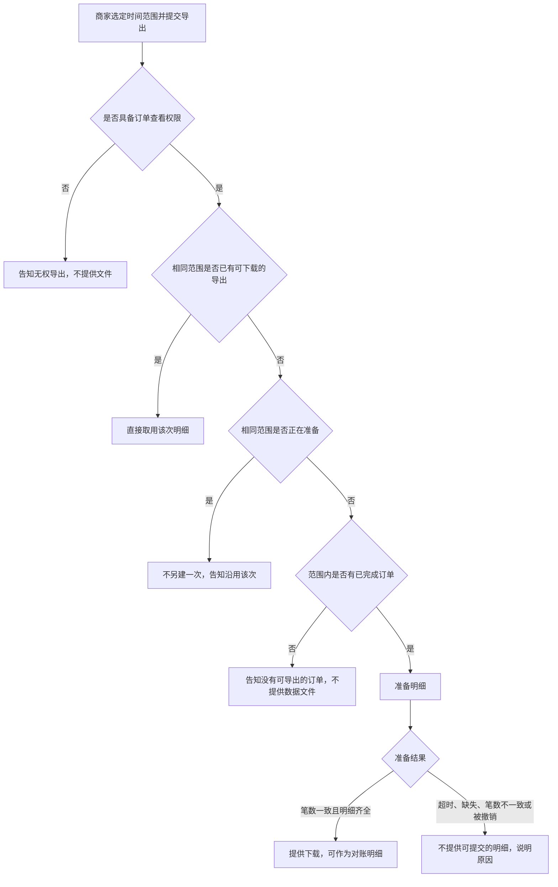

# 成稿示例：商家批量导出订单

本文件演示九段如何写成一篇活文档，并演示规格包如何收纳尚未闭合的细则。决策日志记录了导出范围收窄、残缺文件改为失败状态、以及准备超时。正文已按这些决定改写，并与日志一致。

其中的接口、字段、状态码、文案与仓库名是教学契约，用来示范可核对密度，不是生产事实。不要把本主题的业务事实抄进无关规格。

主规格止于第 9 节。其后是伴随文件的全文。正式输出时，伴随文件单独放在规格包里，不要并进 `SPEC.md` 变成第十段。

## 规格包目录

```text
merchant-order-export-spec/
  SPEC.md
  tbd/retention.md
  assets/export-entry.png
```

路径相对规格包根目录。`SPEC.md` 即下文「商家批量导出订单」。`tbd/retention.md` 的全文附在第 9 节之后。`assets/export-entry.png` 表示订单列表上的导出入口原型；正式规格须放上可打开的文件。

# 商家批量导出订单

## 1. 业务背景

商家须在每月前三个工作日向财务提交已完成订单的明细。目前只能逐单下载，往往无法在窗口关闭前交齐。本期提供按时间范围的一次导出，使具备订单查看权限的商家能够下载与筛选条件一致的明细。成功状态：对账窗口内，商家下载到的明细所含订单笔数，与订单列表在相同筛选下的已完成订单笔数一致。尚无证据表明竞品能力构成这些商家的主要缺口，故不把「竞品均已支持」写成实施理由。

## 2. 用户故事

1. 作为商家运营，在月度对账需要交齐已完成订单明细时，需要按时间范围一次导出这些订单，以便在对账窗口内提交与列表笔数一致的明细。
2. 作为商家财务，在同一次对账中再次索取同一时间范围的明细时，需要得知已有导出是否仍可下载，以便在窗口内直接取用该次明细。

## 3. 流程与路径

商家选定时间范围并提交导出。不具备订单查看权限时，告知无权导出且不提供文件。具备权限时，若相同范围已有可下载的导出，直接取用该次；若该次仍在准备，不另建一次并告知沿用。范围内没有已完成订单时，告知没有可导出的订单，不提供数据文件。有已完成订单时准备明细：笔数一致且明细齐全则提供下载，并允许作为对账明细；超时、明细缺失、笔数不一致或被撤销时，不提供可提交的明细，并说明原因。



## 4. 功能清单

| 能力 | 业务规则 | 对应故事 | 备注（含契约与 TBD） |
|------|----------|----------|----------------------|
| 按时间范围导出已完成订单 | 仅包含 `Order.status = completed`、且 `createdAt` 落在请求范围内的订单。`createdFrom` 与 `createdTo` 为 `YYYY-MM-DD`，按 UTC 日历日包含两端：起始日 00:00:00Z 起，至结束日次日 00:00:00Z 之前。`POST /merchant/orders/exports` 在可新建时返回 202，响应含 `exportId` 与 `status: preparing`。到达 `ready` 且 `reconciliationReady = true` 时，`orderCount` 等于同一筛选下的列表笔数 | 故事 1 | 契约已与工程对齐。权限为 `orders.read`。CSV 列为 `orderId,createdAt,amount,currency,completedAt`。店铺取认证上下文，请求体不含 `shopId` |
| 沿用已有导出 | 同一店铺、相同 `createdFrom` 与 `createdTo`：已有 `preparing` 时不得新建，须返回该次；已有 `ready` 且 `downloadableUntil` 为 `null` 或晚于当前时间时不得新建，须返回该次。`failed` 不阻止新建 | 故事 2 | 可下载天数未闭合。闭合前 `downloadableUntil` 为 `null`。详见 [tbd/retention.md](tbd/retention.md)。责任人：商家产品。期限：2026-10-21 |
| 导出状态与禁止下载 | `ExportStatus` 仅 `preparing`、`ready`、`failed`。`preparing` 与 `failed` 禁止下载。`failed` 时资源上的 `error.code` 仅取 `incomplete_source`、`count_mismatch`、`preparation_timeout`、`cancelled`。`ready` 与 `failed` 无出边 | 故事 1 | 模块：商家订单导出。接口与摘自原型的状态迁移见第 7 节 Implementation Decisions |

## 5. 产品预期

商家在订单列表选定时间范围并确认导出后，能看到该次导出的状态标签。`ready` 且 `reconciliationReady = true` 时，下载到的 CSV 笔数与同一筛选下的已完成订单笔数一致，列为 `orderId,createdAt,amount,currency,completedAt`，并可作为对账明细。原型：`assets/export-entry.png`。

## 6. 边界与异常

| 情形 | 预期行为 |
|------|----------|
| 无 `orders.read` | `POST /merchant/orders/exports` 返回 403，`error.code = orders_read_forbidden`，`error.message` 为「当前账号无权导出订单」，响应无 `exportId`，不创建导出。界面展示同一文案 |
| `createdFrom` 晚于 `createdTo` | POST 返回 422，`error.code = invalid_range`，`error.message` 为「时间范围不合法」，不创建导出 |
| 范围内没有 `completed` 订单 | POST 返回 422，`error.code = no_completed_orders`，`error.message` 为「该范围内没有可导出的已完成订单」，不创建导出。界面展示同一文案 |
| 部分订单明细不可用 | 导出进入 `failed`，资源 `error.code = incomplete_source`，`unavailableOrderIds` 列出这些订单。`GET .../download` 返回 409，`error.code = export_failed`，`error.message` 为「本次导出未完成，不能下载」。界面展示「部分订单明细暂不可用，本次不能作为对账明细」及不可用笔数。禁止下载，禁止把该次标为可提交 |
| 自 `acceptedAt` 起 15 分钟仍为 `preparing` | 进入 `failed`，资源 `error.code = preparation_timeout`。下载返回 409 `export_failed`。界面展示「导出准备超时，请重新导出」。同一范围允许再次 POST |
| 相同范围已有 `preparing` | POST 返回 409，`error.code = export_in_progress`，`error.message` 为「已有相同范围的导出正在准备，请沿用该次」，并返回原 `exportId`。不新建 |
| 撤销 `preparing` | `POST /merchant/orders/exports/{exportId}/cancel` 返回 200，`status = failed`，资源 `error.code = cancelled`。其后下载返回 409 `export_failed`。界面展示「该次导出已撤销」。对 `ready` 或 `failed` 调用 cancel 返回 409，`error.code = export_not_cancellable`，`error.message` 为「仅准备中的导出可以撤销」，状态不变 |
| 结束时 `orderCount` 不等于 `expectedCount` | 进入 `failed`，资源 `error.code = count_mismatch`，响应同时给出 `orderCount` 与 `expectedCount`。下载返回 409 `export_failed`。界面展示「明细笔数与订单列表不一致，请稍后重试」。禁止把该文件作为可提交的对账明细 |
| `preparing` 时请求下载 | `GET /merchant/orders/exports/{exportId}/download` 返回 409，`error.code = export_not_ready`，`error.message` 为「明细尚未准备完成，请稍后下载」。不返回文件 |

## 7. 验收标准

### 可核对条目

1. `POST /merchant/orders/exports` 在调用方具备 `orders.read`、范围合法、范围内存在 `completed` 订单、且没有相同范围的 `preparing` 或仍可沿用的 `ready` 时，返回 202，响应含 `exportId` 与 `status: preparing`。
2. `status` 为 `preparing` 时不得下载。
   1. `GET /merchant/orders/exports/{exportId}/download` 返回 409，`error.code` 为 `export_not_ready`，`error.message` 为「明细尚未准备完成，请稍后下载」。
3. 在生产环境返回 `preparing`、`ready`、`failed` 之前，`merchant-contracts` 的 OpenAPI 枚举 `ExportStatus` 必须包含这三项。
4. 依赖这些状态的客户端开始消费之前，生成的客户端类型必须包含这三项；未知状态不得导致界面抛异常。
5. 商家 Web 对三种 `status` 均渲染标签、tone 与提示，且不抛异常：`preparing` 为「明细准备中」、tone `neutral`；`ready` 为「可下载」、tone `success`，仅当 `reconciliationReady = true` 时提示「可提交为对账明细」；`failed` 为「导出未完成」、tone `danger`。
6. 共享事件 Schema `ExportStatusChanged` 的 `status` 使用 `ExportStatus`，并包含 `exportId` 与可空的 `error.code`。发布说明须写明本功能发出该事件。
7. 范围内有 3 笔 `completed` 订单且明细齐全时，导出到达 `ready` 后 `orderCount` 与 `expectedCount` 均为 3，`reconciliationReady` 为 true，`unavailableOrderIds` 为空。下载返回 200，CSV 表头为 `orderId,createdAt,amount,currency,completedAt`，数据行 3 行，且不含非 `completed` 订单。（故事 1）
8. 不具备 `orders.read` 时，POST 返回 403，`error.code = orders_read_forbidden`，`error.message` 为「当前账号无权导出订单」，响应无 `exportId`。
9. 相同店铺与相同日期范围已有 `preparing` 时，再次 POST 返回 409，`error.code = export_in_progress`，`exportId` 为已有那次，导出资源数不增加。（故事 2）
10. 相同范围已有 `ready` 且 `downloadableUntil` 为 `null` 时，再次 POST 返回 200 与原 `exportId`，不新建。（故事 2）
11. 范围内没有 `completed` 订单时，POST 返回 422，`error.code = no_completed_orders`，不创建导出。
12. 明细不全时资源为 `failed`，`error.code = incomplete_source`，`unavailableOrderIds` 非空；下载返回 409 `export_failed`。界面展示「部分订单明细暂不可用，本次不能作为对账明细」。
13. `acceptedAt` 起满 15 分钟仍为 `preparing` 时，资源变为 `failed`，`error.code = preparation_timeout`。其后同一范围允许再次 POST。
14. 对 `preparing` 调用 cancel 返回 200，`status = failed`，`error.code = cancelled`；其后下载返回 409 `export_failed`。对 `ready` 调用 cancel 返回 409 `export_not_cancellable`，状态保持 `ready`。
15. `orderCount` 不等于 `expectedCount` 时，资源为 `failed`，`error.code = count_mismatch`，两者都出现在 `GET /merchant/orders/exports/{exportId}` 的响应中。下载返回 409 `export_failed`。
16. 测试必须覆盖：取得 `preparing` 并拒绝下载；`ready` 文件行数与列表笔数一致；无权限时 403；重复 `preparing` 返回同一 `exportId`；第 6 节其余各行的状态码与文案。
17. PR 描述必须链接 Jira `MERCH-1842` 与 Confluence 页面「商家订单导出发布说明」。
18. 可下载天数在 [tbd/retention.md](tbd/retention.md) 闭合前：`downloadableUntil` 为 `null`，下载不因时间返回 410。禁止把该文件中的占位天数实现为规则。

### Implementation Decisions

- 模块：商家订单导出（新建，负责受理、迁移、下载、撤销）；商家订单查询（既有，只读 `completed` 订单的计数与明细字段）；商家 Web 导出面板（修改标签、提示、下载与撤销）；`merchant-contracts`（`ExportStatus`、错误体、`ExportStatusChanged`）。
- 接口：`POST /merchant/orders/exports`；`GET /merchant/orders/exports/{exportId}`；`GET /merchant/orders/exports/{exportId}/download`；`POST /merchant/orders/exports/{exportId}/cancel`。
- 资源字段：`exportId`、`shopId`、`createdFrom`、`createdTo`、`status`、`orderCount`、`expectedCount`、`reconciliationReady`、`unavailableOrderIds`、`error.code`、`acceptedAt`、`downloadableUntil`。`shopId` 来自认证上下文。错误体为 `{ "error": { "code", "message" } }`；需要沿用已有导出时，同时返回 `exportId`。
- 交互：相同店铺与日期范围在 `preparing` 期间拒绝新建；`ready` 且未过期时返回已有 `exportId`；`failed` 不参与沿用。进入 `ready` 时 `reconciliationReady` 必须为 true。下载仅在该条件下返回 200；否则返回 409，`error.code = export_failed`。
- 摘自原型的状态迁移（只保留决定，不是可运行实现）：

```text
preparing → ready    当 reconciliationReady
preparing → failed   当 incomplete_source | count_mismatch | preparation_timeout | cancelled
ready 与 failed 无出边
```

### Testing Decisions

- 合格测试只断言外部行为：HTTP 状态、`error.code`、`error.message`、`status`、文件行数、界面标签与提示。不断言作业调度、存储键或私有函数。
- 模块：商家订单导出 API；商家 Web 导出面板。
- 既有可对照测试：订单列表按 `status = completed` 与日期范围筛选的接口测试；订单读接口的 403 测试；Web 订单状态标签的渲染测试。

### Reviewer 对照检查

- `izelzzz/merchant-api` 中导出接口的状态、错误码与下载行为
- `izelzzz/merchant-contracts` 中 `ExportStatus`、错误体与 `ExportStatusChanged`
- `izelzzz/merchant-web` 中导出状态的标签、tone 与提示
- `merchant-contracts` 中事件 Schema 是否已包含 `preparing`、`ready`、`failed`

## 8. 术语表

| 术语 | 在本规格中的含义 | 不包括 | 边界 |
|------|------------------|--------|------|
| 已完成订单 | `Order.status = completed` 的订单 | `pending`；`cancelled`；`refunded`；任何非 `completed` | 与列表筛选 `status=completed` 同一枚举；导出文件不得写入其他状态 |
| 导出 | 一次导出请求及其 `ExportStatus` | 队列；对象存储；后台作业实现 | `preparing` 不可下载；`ready` 且 `reconciliationReady = true` 才可下载并作为对账明细；`failed` 不可下载且为终态 |
| 批量 | 同一店铺、同一日期范围内全部已完成订单的一次导出 | 跨店铺；未完成订单；把多次请求拼成一次 | 范围由 `createdFrom`、`createdTo` 按第 4 节的 UTC 日历日决定 |
| 沿用 | 不新建导出，返回已有 `exportId` | 复制文件；对 `failed` 自动重试 | 仅当已有 `preparing`，或 `ready` 且 `downloadableUntil` 为 `null` 或未到期 |
| 订单查看权限 | 调用导出接口所需的权限 `orders.read` | 财务角色名称本身；店铺管理员的其他权限 | 无 `orders.read` 时 POST 返回 403 `orders_read_forbidden`，不创建导出 |
| 对账窗口 | 每月前三个工作日，商家须在此期间提交明细 | 自然月的其余日期；下载接口的技术超时 | 窗口内故事 2 要求仍可取用的条件见 [tbd/retention.md](tbd/retention.md)；闭合前不得用占位天数截断下载 |

## 9. 决策日志

| 时间 | 变更点 | 理由 | 决策人 |
|------|--------|------|--------|
| 2026-10-06 | 确立按时间范围一次导出订单明细 | 商家须在每月前三个工作日交齐明细，逐单下载无法在窗口内完成 | 商家产品负责人 |
| 2026-10-08 | 导出范围由全部状态改为仅 `completed`；故事、功能规则与验收同步收窄 | 对账只核已完成订单；纳入其他状态后，明细笔数无法与对账清单对照 | 商家产品负责人 |
| 2026-10-14 | 部分明细不可用时不再交付残缺文件；改为 `failed` / `incomplete_source` 并禁止下载。验收改为点名导出 API、`ExportStatus` 与错误码 | 残缺文件仍可能被当成已交齐的对账明细；状态与错误码不确定时，实现无法判定通过或失败 | 商家产品负责人 |
| 2026-10-14 | 准备超过 `acceptedAt` 起 15 分钟仍未完成则 `preparation_timeout` | 对账窗口内需要明确的失败，商家才能对同一范围重新导出 | 商家产品负责人；已与工程对齐 |

---

# 伴随文件：`tbd/retention.md`

以下内容在规格包中是独立文件。它补主规格第 4 节「沿用已有导出」、第 7 节可核对条目 18、以及术语「对账窗口」。不要把它抄进 `SPEC.md` 的第 10 节。

```markdown
# 可下载期限

补 `SPEC.md` 第 4 节「沿用已有导出」、第 7 节可核对条目 18、术语「对账窗口」。
责任人：商家产品。期限：2026-10-21。

## 已掌握

- 仅 `status = ready` 且 `reconciliationReady = true` 的导出可以下载。
- 资源字段 `downloadableUntil` 已列入契约，类型为可空时间戳。
- 本项闭合前，`downloadableUntil` 必须为 `null`。下载不因时间失效，也不得返回 410。
- 相同店铺与相同 `createdFrom`、`createdTo` 的 `ready` 导出，在 `downloadableUntil` 为 `null` 时，再次 POST 返回 200 与原 `exportId`。

## 待决

- `ready` 之后多少个整日仍可下载。时长尚未与商家产品闭合。

## 约束

- 时长必须覆盖创建当日之后、当月对账窗口剩余的工作日。短于该窗口时，故事 2 不能成立：财务无法在同一窗口内再次取用该次明细。

## 假设（禁止实现）

- 7 日。此数只是占位，不是规则。不得写入接口默认值、配置或验收。

## 闭合后要改的契约

- 将 `downloadableUntil` 定为到达 `ready` 的时刻起算的明确时长。
- 到期后 `GET /merchant/orders/exports/{exportId}/download` 返回 410，`error.code = export_expired`，`error.message` 为「该次导出已超过可下载期限，请重新导出」。界面展示同一文案。
- 到期后的相同筛选允许新建导出，不再返回原 `exportId`。
- 在 `SPEC.md` 第 7 节补一条点名 410 与 `export_expired` 的可核对条目，并在决策日志追加本决定。在此之前不要实现到期逻辑。
```
