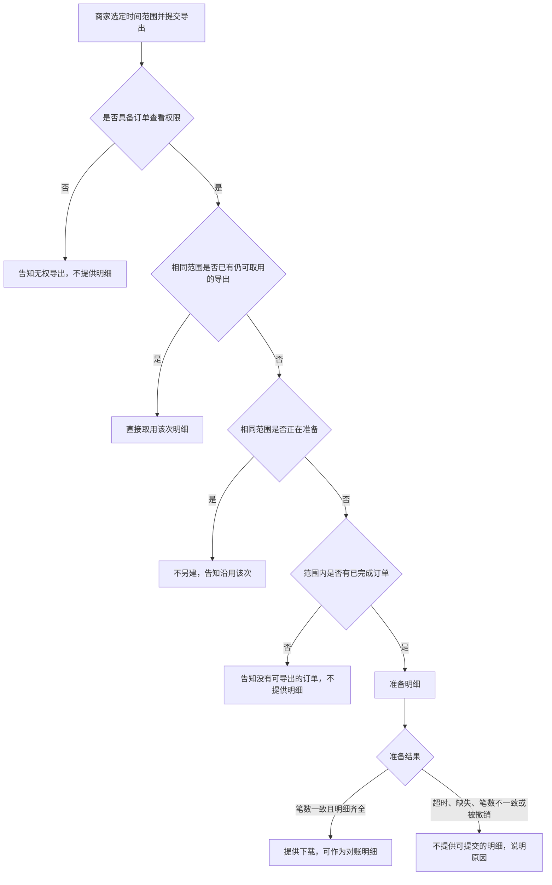

# 成稿示例：商家批量导出订单

活文档。只示范业务语言的详略，不示范接口。不要把本案事实抄进无关规格。可取用天数仍未决，备注里写已掌握与待决，不写成规则。

# 商家批量导出订单

## 1. 业务目标

商家须在每月前三个工作日向财务提交已完成订单的明细。目前只能逐单下载，往往无法在窗口关闭前交齐。本期提供按时间范围的一次导出，使具备订单查看权限的商家取得与列表相同筛选下的已完成订单明细。成功状态：对账窗口内，所下载明细的订单笔数与订单列表在相同筛选下的已完成订单笔数一致。尚无证据表明竞品能力是主要缺口，故不把「竞品均已支持」写成实施理由。

## 2. 业务结构

### 角色、场景与范围

- 角色：商家运营提交导出；商家财务在同一对账中再次取用。财务核对笔数，不另建一套导出规则。
- 场景：月度对账窗口（每月前三个工作日）内，按时间范围取得已完成订单明细。窗口外的历史查询不在本期。
- 包含：具备订单查看权限的商家，按时间范围一次导出已完成订单；相同范围已有进行中或仍可取用的导出时沿用该次；进行中的导出可以撤销。
- 不包含：未完成订单；无订单查看权限的账号；成功后可取用的天数（未决，见第 4 节）。
- 本期无单独原型。商家在订单列表中选定时间范围并确认导出。

### 流程与路径

商家选定时间范围并提交导出。无订单查看权限则告知无权，不提供明细。有权限时：已有仍可取用的同范围导出则直接取用；仍在准备则不另建，并告知沿用；此前已失败的同范围导出不阻止新建。范围内没有已完成订单则告知无可导出，不提供明细。有则准备明细：笔数一致且内容齐全则提供下载，可作为对账明细；超时、缺失、笔数不一致或被撤销则不提供可提交明细，并说明原因。仅进行中的导出可以撤销。

## 3. 用户故事

1. 作为商家运营，在月度对账需要交齐已完成订单明细时，需要按时间范围一次导出这些订单，以便在对账窗口内提交与列表笔数一致的明细。
2. 作为商家财务，在同一次对账中再次索取同一时间范围的明细时，需要得知已有导出是否仍可取用，以便在窗口内直接取用该次明细。

## 4. 功能清单

| 能力 | 业务规则 | 对应故事 | 备注 |
|------|----------|----------|------|
| 按时间范围导出已完成订单 | 仅包含已完成、且创建日落在所选范围内的订单，范围含两端。明细须含订单标识、创建日、金额、币种与完成时间。笔数须与同一筛选下的订单列表一致。无订单查看权限的账号不得导出 | 故事 1 | |
| 沿用已有导出 | 同一店铺、相同时间范围：已有进行中的导出，或已成功且仍可取用的导出，不得另建，须沿用该次。已失败的导出不阻止新建 | 故事 2 | |
| 撤销进行中的导出 | 仅进行中的导出可以撤销。撤销后不提供可提交明细，并说明已撤销。已成功或已失败的导出不得撤销，该次结果保持不变 | 故事 1 | |
| 可取用期限 | 成功导出后，商家在当月对账窗口内须仍能取用该次明细 | 故事 2 | 未决。已掌握：至少覆盖当月对账窗口剩余工作日。待决：窗口结束后是否仍可取用，以及可取用天数。责任人：商家产品。期限：2026-10-21。闭合前不把任一具体天数写成规则 |

## 5. 边界与异常

| 情形 | 业务预期 |
|------|----------|
| 无订单查看权限 | 告知无权导出，不提供明细 |
| 范围内无已完成订单 | 告知没有可导出的订单，不提供明细 |
| 相同范围已有进行中的导出 | 不另建，告知沿用该次 |
| 相同范围已有仍可取用的成功导出 | 不另建，直接取用该次明细 |
| 相同范围的导出已失败 | 不沿用该次，允许按同一范围新建 |
| 准备未完成（超时、明细缺失或笔数不一致） | 不提供可提交的明细，并说明原因 |
| 撤销进行中的导出 | 不再提供可提交明细，并说明已撤销 |
| 撤销已成功或已失败的导出 | 不改变该次导出，并说明仅进行中的导出可以撤销 |
| 准备尚未完成时索取下载 | 不提供文件，说明尚未可提交 |

## 6. 验收标准

1. 具备订单查看权限的商家，在范围内存在已完成订单、且没有相同范围的进行中或仍可取用导出时，提交一次导出后得到一份明细。该明细只含已完成订单，含订单标识、创建日、金额、币种与完成时间，笔数与同一时间范围下订单列表的已完成订单笔数一致。（故事 1）
2. 商家财务在同一次对账中再次索取同一时间范围时，若该次导出仍可取用，得到的是同一次明细，而不是另一份。（故事 2）
3. 第 5 节各情形的业务预期即为该情形的验收。此处不逐条复述。

## 7. 术语表

| 术语 | 在本规格中的含义 | 不包括 | 边界 |
|------|------------------|--------|------|
| 已完成订单 | 已完结、可纳入对账清单的订单 | 未完结的订单 | 与订单列表中「已完成」为同一含义 |
| 导出 | 商家按一次时间范围取得的一份已完成订单明细 | 逐单下载 | 仅当明细齐全且笔数与列表一致时，方可作为对账明细 |
| 沿用 | 不另建导出，取用已有的同范围明细 | 对已失败的导出自动重做 | 已有进行中的导出，或已成功且仍可取用的导出 |
| 仍可取用 | 该次成功导出在当前时点仍可供同一店铺下载 | 已失败的导出 | 可取用天数未决，见第 4 节 |
| 对账窗口 | 每月前三个工作日 | 其余日期 | 窗口内提交的明细须与列表笔数一致 |

## 8. 决策日志

| 时间 | 变更点 | 理由 | 决策人 |
|------|--------|------|--------|
| 2026-10-06 | 确立按时间范围一次导出已完成订单明细 | 商家须在每月前三个工作日交齐明细，逐单下载无法在窗口内完成 | 商家产品负责人 |
| 2026-10-08 | 导出范围由全部订单改为仅已完成订单；故事、规则与验收同步收窄 | 对账只核已完成订单，其他状态无法与对账清单对照笔数 | 商家产品负责人 |
