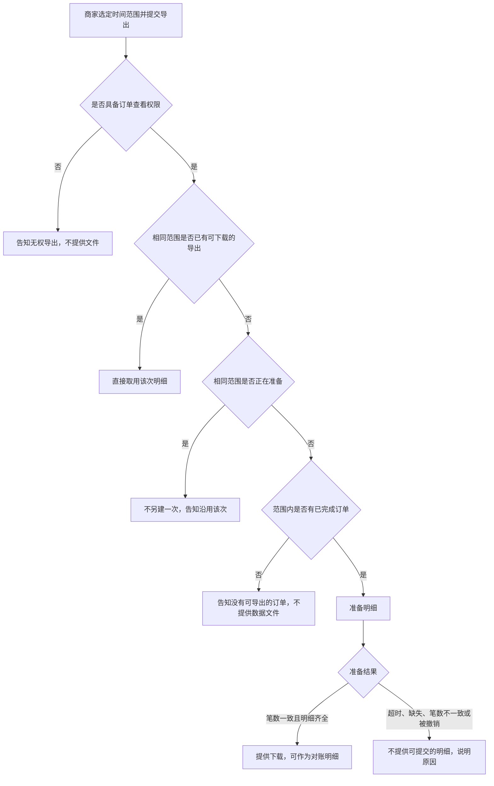

# 成稿示例：商家批量导出订单

九段活文档。接口、字段、状态码与仓库名是教学契约，不是生产事实。不要抄进无关规格。伴随文件不并进 `SPEC.md`。

规格包：

```text
merchant-order-export-spec/
  SPEC.md
  tbd/retention.md
  assets/export-entry.png
```

下文即 `SPEC.md`。可下载天数在 `tbd/retention.md`；本仓库副本：[example-package/tbd/retention.md](example-package/tbd/retention.md)。写入真实规格包时，把该链接改为 `tbd/retention.md`。`assets/export-entry.png` 为导出入口原型，正式规格须放上可打开的文件。发布检查只写真实工单，本示例不虚构单号。

决策日志记录范围收窄为仅 `completed`。正文已按该决定改写。

# 商家批量导出订单

## 1. 业务背景

商家须在每月前三个工作日向财务提交已完成订单的明细。目前只能逐单下载，往往无法在窗口关闭前交齐。本期提供按时间范围的一次导出，使具备订单查看权限的商家下载与筛选条件一致的明细。成功状态：对账窗口内，下载明细的订单笔数与订单列表在相同筛选下的已完成订单笔数一致。尚无证据表明竞品能力是主要缺口，故不把「竞品均已支持」写成实施理由。

## 2. 用户故事

1. 作为商家运营，在月度对账需要交齐已完成订单明细时，需要按时间范围一次导出这些订单，以便在对账窗口内提交与列表笔数一致的明细。
2. 作为商家财务，在同一次对账中再次索取同一时间范围的明细时，需要得知已有导出是否仍可下载，以便在窗口内直接取用该次明细。

## 3. 流程与路径

商家选定时间范围并提交导出。无订单查看权限则告知无权、不提供文件。有权限时：已有可下载的同范围导出则直接取用；仍在准备则不另建并告知沿用。范围内无已完成订单则告知无可导出、不提供数据文件。有则准备明细：笔数一致且齐全则提供下载；超时、缺失、笔数不一致或被撤销则不提供可提交明细并说明原因。



## 4. 功能清单

| 能力 | 业务规则 | 对应故事 | 备注（含契约与 TBD） |
|------|----------|----------|----------------------|
| 按时间范围导出已完成订单 | 仅含 `Order.status = completed` 且 `createdAt` 落在范围内的订单。`createdFrom`、`createdTo` 为 `YYYY-MM-DD`，UTC 日历日含两端。可新建时 `POST /merchant/orders/exports` 返回 202，响应含 `exportId` 与 `status: preparing`。`ready` 且 `reconciliationReady = true` 时，`orderCount` 等于同一筛选的列表笔数 | 故事 1 | 已与工程对齐。权限 `orders.read`。CSV 列 `orderId,createdAt,amount,currency,completedAt`。`shopId` 取认证上下文，请求体不含该字段 |
| 沿用已有导出 | 同一店铺、相同 `createdFrom` 与 `createdTo`：已有 `preparing`，或 `ready` 且 `downloadableUntil` 为 `null` 或未到期，不得新建，须返回该次。`failed` 不阻止新建 | 故事 2 | 可下载天数未闭合。闭合前 `downloadableUntil` 为 `null`。详见 [tbd/retention.md](example-package/tbd/retention.md)。责任人：商家产品。期限：2026-10-21 |
| 导出状态 | `ExportStatus` 仅 `preparing`、`ready`、`failed`。`preparing` 与 `failed` 禁止下载。`ready` 与 `failed` 无出边 | 故事 1 | 模块：商家订单导出。状态迁移见第 7 节 |

## 5. 产品预期

商家在订单列表选定时间范围并确认导出后，能看到该次导出的状态标签。`ready` 且 `reconciliationReady = true` 时，下载到的 CSV 笔数与同一筛选下的已完成订单笔数一致，列为 `orderId,createdAt,amount,currency,completedAt`，并可作为对账明细。原型：`assets/export-entry.png`。

## 6. 边界与异常

| 情形 | 预期行为 |
|------|----------|
| 无 `orders.read` | `POST /merchant/orders/exports` 返回 403，`error.code = orders_read_forbidden`，`error.message` 为「当前账号无权导出订单」，无 `exportId`，不创建导出 |
| 范围内无 `completed` 订单 | POST 返回 422，`error.code = no_completed_orders`，`error.message` 为「该范围内没有可导出的已完成订单」，不创建导出 |
| 相同范围已有可沿用导出 | 已有 `preparing`：POST 返回 409，`error.code = export_in_progress`，返回原 `exportId`，文案「已有相同范围的导出正在准备，请沿用该次」，不新建。已有 `ready` 且 `downloadableUntil` 为 `null` 或未到期：返回 200 与原 `exportId`，不新建 |
| 准备失败后下载 | 进入 `failed` 后 `GET /merchant/orders/exports/{exportId}/download` 返回 409，`error.code = export_failed`，`error.message` 为「本次导出未完成，不能下载」，不返回文件。资源 `error.code`：明细缺失为 `incomplete_source`，笔数不一致为 `count_mismatch`，自 `acceptedAt` 起 15 分钟仍 `preparing` 为 `preparation_timeout` |
| 撤销 `preparing` | `POST /merchant/orders/exports/{exportId}/cancel` 返回 200，`status = failed`，资源 `error.code = cancelled`。对 `ready` 或 `failed` 调用 cancel 返回 409，`error.code = export_not_cancellable`，`error.message` 为「仅准备中的导出可以撤销」，状态不变 |

## 7. 验收标准

### 可核对条目

1. `POST /merchant/orders/exports` 在具备 `orders.read`、范围合法、范围内存在 `completed` 订单、且没有相同范围的 `preparing` 或仍可沿用的 `ready` 时，返回 202，响应含 `exportId` 与 `status: preparing`。
2. `status` 为 `preparing` 时不得下载。
   1. `GET /merchant/orders/exports/{exportId}/download` 返回 409，`error.code = export_not_ready`，`error.message` 为「明细尚未准备完成，请稍后下载」。
3. 生产环境返回 `preparing`、`ready`、`failed` 之前，`merchant-contracts` 的 OpenAPI 枚举 `ExportStatus` 必须包含这三项；生成的客户端类型必须包含这三项。未知状态不得导致界面抛异常。
4. 商家 Web 对三种 `status` 渲染标签与 tone，且不抛异常：`preparing`「明细准备中」/`neutral`；`ready`「可下载」/`success`，仅 `reconciliationReady = true` 时提示「可提交为对账明细」；`failed`「导出未完成」/`danger`。
5. 事件 `ExportStatusChanged` 的 `status` 使用 `ExportStatus`，并含 `exportId` 与可空 `error.code`。发布说明写明本功能发出该事件。
6. 范围内 3 笔 `completed` 且明细齐全时，到达 `ready` 后 `orderCount` 与 `expectedCount` 均为 3，`reconciliationReady = true`。下载返回 200，CSV 表头 `orderId,createdAt,amount,currency,completedAt`，数据行 3 行，且不含非 `completed` 订单。（故事 1）
7. 第 6 节每一行的状态码、`error.code` 与文案均为验收条件。故事 2 的沿用以「相同范围已有可沿用导出」行为准。
8. [tbd/retention.md](example-package/tbd/retention.md) 闭合前，`downloadableUntil` 为 `null`，下载不因时间返回 410。禁止把该文件中的占位天数实现为规则。

### Implementation Decisions

- 模块：商家订单导出（新建：受理、迁移、下载、撤销）；商家订单查询（既有，只读 `completed` 的计数与明细）；商家 Web 导出面板（标签、提示、下载、撤销）；`merchant-contracts`（`ExportStatus`、错误体、`ExportStatusChanged`）。
- 接口：`POST /merchant/orders/exports`；`GET /merchant/orders/exports/{exportId}`；`GET /merchant/orders/exports/{exportId}/download`；`POST /merchant/orders/exports/{exportId}/cancel`。
- 资源字段：`exportId`、`shopId`（认证上下文）、`createdFrom`、`createdTo`、`status`、`orderCount`、`expectedCount`、`reconciliationReady`、`unavailableOrderIds`、`error.code`、`acceptedAt`、`downloadableUntil`。错误体 `{ "error": { "code", "message" } }`；沿用时同时返回 `exportId`。
- 交互：`preparing` 期间拒绝新建；`ready` 且未过期返回已有 `exportId`；`failed` 不参与沿用。进入 `ready` 时 `reconciliationReady` 为 true。仅此时下载返回 200。`preparing` 下载返回 409 `export_not_ready`；`failed` 下载返回 409 `export_failed`。
- 摘自原型的状态迁移（只保留决定）：

```text
preparing → ready    当 reconciliationReady
preparing → failed   当 incomplete_source | count_mismatch | preparation_timeout | cancelled
ready 与 failed 无出边
```

### Testing Decisions

- 合格测试只断言外部行为：HTTP 状态、`error.code`、`error.message`、`status`、文件行数、界面标签。不断言调度、存储键或私有函数。
- 模块：商家订单导出 API；商家 Web 导出面板。
- 既有可对照测试：订单列表按 `status = completed` 与日期范围筛选；订单读接口的 403；Web 订单状态标签。
- 发布检查：PR 描述链接本案工单与发布说明。

### Reviewer 对照检查

- `izelzzz/merchant-api`：导出的状态、错误码与下载
- `izelzzz/merchant-contracts`：`ExportStatus`、错误体、`ExportStatusChanged` 是否包含 `preparing`、`ready`、`failed`
- `izelzzz/merchant-web`：导出状态的标签、tone 与提示

## 8. 术语表

| 术语 | 在本规格中的含义 | 不包括 | 边界 |
|------|------------------|--------|------|
| 已完成订单 | `Order.status = completed` 的订单 | 任何非 `completed` | 与列表筛选同一枚举 |
| 导出 | 一次导出请求及其 `ExportStatus` | 队列、存储与作业实现 | 仅 `ready` 且 `reconciliationReady = true` 可下载 |
| 沿用 | 不新建导出，返回已有 `exportId` | 对 `failed` 自动重试 | 已有 `preparing`，或 `ready` 且未过可下载期限 |
| 对账窗口 | 每月前三个工作日 | 其余日期；下载接口超时 | 窗口内仍可取用的天数见第 4 节备注 |

## 9. 决策日志

| 时间 | 变更点 | 理由 | 决策人 |
|------|--------|------|--------|
| 2026-10-06 | 确立按时间范围一次导出订单明细 | 商家须在每月前三个工作日交齐明细，逐单下载无法在窗口内完成 | 商家产品负责人 |
| 2026-10-08 | 导出范围由全部状态改为仅 `completed`；故事、规则与验收同步收窄 | 对账只核已完成订单，其他状态无法与对账清单对照笔数 | 商家产品负责人 |
