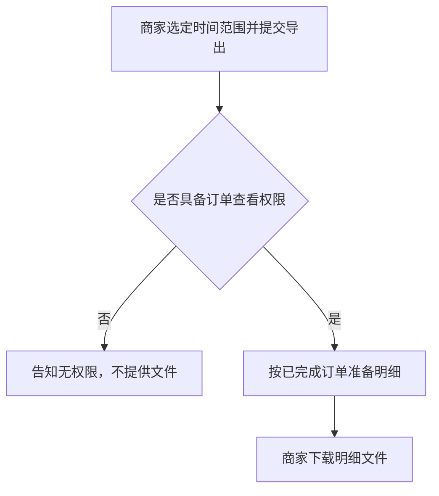

# 成稿示例：商家批量导出订单

本文件演示九段如何写成一篇活文档。决策日志的第二条记录导出范围由全部状态收窄为仅已完成订单；正文已按收窄后的范围改写，并与日志一致。写法对照用，不要把本主题的业务事实抄进无关规格。

# 商家批量导出订单

## 1. 业务背景

商家须在每月前三个工作日向财务提交已完成订单的明细。目前只能逐单下载，往往无法在窗口关闭前交齐。本期提供按时间范围的一次导出，使具备订单查看权限的商家能够下载与筛选条件一致的明细。成功状态：对账窗口内，商家下载到的明细所含订单笔数，与订单列表在相同筛选下的已完成订单笔数一致。尚无证据表明竞品能力构成这些商家的主要缺口，故不把「竞品均已支持」写成实施理由。

## 2. 用户故事

1. 作为商家运营，在月度对账需要交齐已完成订单明细时，需要按时间范围一次导出这些订单，以便在对账窗口内提交与列表笔数一致的明细。
2. 作为商家财务，在同一次对账中再次索取同一时间范围的明细时，需要得知已有导出是否仍可下载，以便在窗口内直接取用该次明细。

## 3. 流程与路径

商家选定时间范围并提交导出。不具备订单查看权限时，告知无权限且不提供文件。具备权限时，按已完成订单准备明细，再由商家下载。

## 4. 功能清单

| 能力 | 业务规则 | 对应故事 | 备注（含 TBD） |
|------|----------|----------|----------------|
| 按时间范围导出已完成订单 | 仅包含状态为已完成、且下单时间落在所选范围内的订单；文件笔数与同一筛选下的列表笔数一致 | 故事 1 | 对账所需字段已与工程对齐 |
| 沿用已有导出 | 同一商家、相同筛选下，已完成且仍可下载的导出可直接再次下载；进行中的相同请求不另建一次 | 故事 2 | 文件可下载天数 TBD；责任人：商家产品；期限：2026-10-21 |

## 5. 产品预期

商家在订单列表选定时间范围并确认导出后，能下载一份明细文件；文件中的订单笔数与同一筛选下的已完成订单笔数一致，字段可供对账使用。订单列表上的导出入口附原型（或线上演示）。

## 6. 边界与异常

| 情形 | 预期行为 |
|------|----------|
| 无订单查看权限 | 不提供文件，并告知当前账号无权导出 |
| 所选范围内没有已完成订单 | 不提供含数据行的文件，并告知该范围内没有可导出的订单 |
| 部分订单明细暂不可用 | 已可提供的订单写入文件；不可用的订单逐笔记入说明；不把整批标为已按筛选条件交齐 |
| 导出超时 | 该次导出保持未完成，商家可稍后重试同一范围；未完成的结果不可下载 |
| 重复提交相同筛选 | 已有进行中的相同导出时不另建一次，并告知商家沿用该次 |
| 撤销尚未完成的导出 | 停止该次导出，不提供未完成的文件 |
| 文件笔数与列表不一致 | 不把该文件作为可提交的对账明细；告知商家稍后重试，并保留该次不一致供核对 |

## 7. 验收标准

- 给定商家具备订单查看权限，且所选时间范围内有 3 笔已完成订单 → 当商家确认导出 → 则提供可下载文件，其中含这 3 笔，且不含未完成订单。（对应故事 1）
- 给定同一商家已有相同筛选、且仍可下载的导出 → 当商家再次索取该范围的明细 → 则直接提供该次文件，不另建一次导出。（对应故事 2）
- 给定商家不具备订单查看权限 → 当商家确认导出 → 则不提供文件，并展示当前账号无权导出的说明。（对应流程中的权限分支）

## 8. 术语表

| 术语 | 定义 | 不包括 |
|------|------|--------|
| 批量 | 一次操作覆盖所选时间范围内的全部已完成订单 | 跨店铺合并；未完成订单 |
| 导出任务 | 商家一次导出请求，以及该次请求是否已完成、可否下载 | 后台作业、队列或文件存储方式 |

## 9. 决策日志

| 时间 | 变更点 | 理由 | 决策人 |
|------|--------|------|--------|
| 2026-10-06 | 确立按时间范围一次导出订单明细 | 商家须在每月前三个工作日交齐明细，逐单下载无法在窗口内完成 | 商家产品负责人 |
| 2026-10-08 | 导出范围由全部状态改为仅已完成订单；故事、功能规则与验收同步收窄 | 对账只核已完成订单；纳入其他状态后，明细笔数无法与对账清单对照 | 商家产品负责人 |
