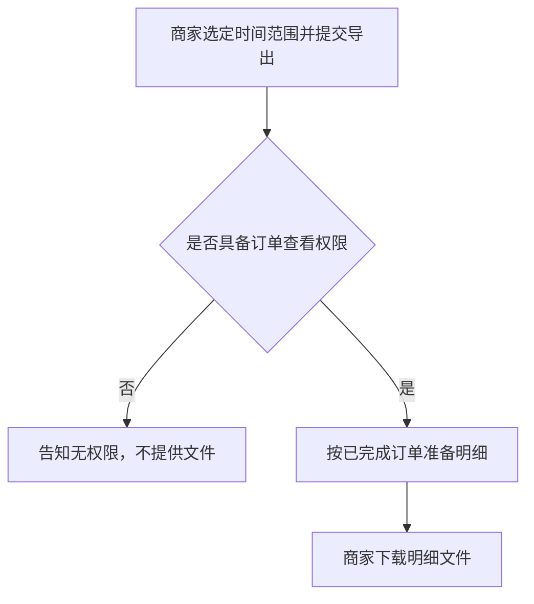

# 九段要求与示例

填写、补写或评审产品规格文档时对照本文件。各段先满足要求，再按示例的体裁填写。未知事项标为 `TBD`，并写明补充责任人与期限；没有责任人与期限的 `TBD` 会变成无人认领的空洞。

## 1. 业务背景

业务背景说明为何实施、为何此时实施，以及成功状态的定义。成功状态须可观察；不得以「体验更好」等不可核对表述单独充当成功定义。未经验证的市场判断不得写成既定事实。把尚未核对的判断写成事实，会使后续故事与验收建立在错误前提上。

**示例**

商家须在每月前三个工作日向财务提交已完成订单的明细。目前只能逐单下载，往往无法在窗口关闭前交齐。本期提供按时间范围的一次导出，使具备订单查看权限的商家能够下载与筛选条件一致的明细。成功状态：对账窗口内，商家下载到的明细所含订单笔数，与订单列表在相同筛选下的已完成订单笔数一致。尚无证据表明竞品能力构成这些商家的主要缺口，故不把「竞品均已支持」写成实施理由。

## 2. 用户故事

用户故事使用固定句式：`作为 [角色]，在 [场景] 下，需要 [能力]，以便 [价值]。` 故事描述意图，不描述实现方式。每条故事至少对应一条验收标准，使开发与测试有共同判据。角色是提出该需求或受该能力影响的人，不要写成「系统」；以系统为角色时，故事无法对应到可验收的使用意图。

**示例**

1. 作为商家运营，在月度对账需要交齐已完成订单明细时，需要按时间范围一次导出这些订单，以便在对账窗口内提交与列表笔数一致的明细。
2. 作为商家财务，在同一次对账中再次索取同一时间范围的明细时，需要得知已有导出是否仍可下载，以便在窗口内直接取用该次明细。

## 3. 流程与路径

流程与路径描述业务流程，不描述技术架构。步骤应当能读出业务动作、交接对象，以及在何种条件下走向哪一条分支。存在多个角色、多种状态或较多分支时，用 Mermaid 绘制：角色之间的交接宜用 `sequenceDiagram`，状态与条件分支宜用 `flowchart`。图中只保留业务步骤、交接与分支。接口、存储或队列等实现细节不写入本图，以便评审核对的是业务步骤是否成立。

**示例**

## 4. 功能清单

功能清单按能力列出业务规则，并标明每条能力对应哪一条用户故事。规则写业务上允许什么、在何种条件下成立，不写实现步骤。涉及接口或数据模型的技术备注，须先与工程对齐后再写入备注栏；对齐之前，不把实现设想写成已定规则。尚未确定的事项标注为 `TBD`，并写明补充责任人与期限。

**示例**

| 能力 | 业务规则 | 对应故事 | 备注（含 TBD） |
|------|----------|----------|----------------|
| 按时间范围导出已完成订单 | 仅包含状态为已完成、且下单时间落在所选范围内的订单；文件笔数与同一筛选下的列表笔数一致 | 故事 1 | 对账所需字段已与工程对齐 |
| 沿用已有导出 | 同一商家、相同筛选下，已完成且仍可下载的导出可直接再次下载；进行中的相同请求不另建一次 | 故事 2 | 文件可下载天数 TBD；责任人：商家产品；期限：2026-10-21 |

## 5. 产品预期

产品预期写使用者获得该能力之后应当达到的状态，并且该状态须可观察。存在用户界面时，附上原型或线上演示，使预期能够对照界面核对。没有用户界面时，写明调用方能够得到的效果，并将界面项标为不适用。

**示例**

商家在订单列表选定时间范围并确认导出后，能下载一份明细文件；文件中的订单笔数与同一筛选下的已完成订单笔数一致，字段可供对账使用。订单列表上的导出入口须附原型或线上演示。若本次仅提供调用、没有界面，则写明调用方获得的文件或失败说明，并把界面项标为不适用。

## 6. 边界与异常

边界与异常写权限、空态、失败、超时后的重试、重复提交、回退撤销，以及与外部结果不一致等情形。每一情形都写出业务上的预期行为，使这些路径与主路径一样可以被验收。只列出情形、不写预期行为，该路径仍是缺口，应在本段补上，或标为 `TBD` 并指定责任人与期限。

**示例**

| 情形 | 预期行为 |
|------|----------|
| 无订单查看权限 | 不提供文件，并告知当前账号无权导出 |
| 所选范围内没有已完成订单 | 不提供含数据行的文件，并告知该范围内没有可导出的订单 |
| 部分订单明细暂不可用 | 已可提供的订单写入文件；不可用的订单逐笔记入说明；不把整批标为已按筛选条件交齐 |
| 导出超时 | 该次导出保持未完成，商家可稍后重试同一范围；未完成的结果不可下载 |
| 重复提交相同筛选 | 已有进行中的相同导出时不另建一次，并告知商家沿用该次 |
| 撤销尚未完成的导出 | 停止该次导出，不提供未完成的文件 |
| 文件笔数与列表不一致 | 不把该文件作为可提交的对账明细；告知商家稍后重试，并保留该次不一致供核对 |

## 7. 验收标准

验收标准须能判定通过或失败，采用给定、当、则的写法：先写前置条件，再写执行的动作，最后写可观察的结果。结果落在数据、界面或调用返回上，使人能够核对。不要单独使用「体验良好」「尽量快速」「用户满意」等无法核对的表述；若业务上必须讨论体验或速度，同时给出可观察的代理指标，否则验收会变成主观争论。

**示例**

- 给定商家具备订单查看权限，且所选时间范围内有 3 笔已完成订单 → 当商家确认导出 → 则提供可下载文件，其中含这 3 笔，且不含未完成订单。
- 给定商家不具备订单查看权限 → 当商家确认导出 → 则不提供文件，并展示当前账号无权导出的说明。

## 8. 术语表

术语表为正文中的领域术语给出统一定义，并写明该术语不包括何种含义。故事、流程与验收使用同一术语时，含义以术语表为准，避免同一词在各段各指一事。

**示例**

| 术语 | 定义 | 不包括 |
|------|------|--------|
| 批量 | 一次操作覆盖所选时间范围内的全部已完成订单 | 跨店铺合并；未完成订单 |
| 导出任务 | 商家一次导出请求，以及该次请求是否已完成、可否下载 | 后台作业、队列或文件存储方式 |

## 9. 决策日志

决策日志使规格保持为活文档。范围、流程或验收一旦变更，追加一条记录，写明时间、变更点、理由与决策人。正文可随之修订，但变更本身须留在日志中。只改正文、不留记录，工程与测试会对着过期文档工作。

**示例**

| 时间 | 变更点 | 理由 | 决策人 |
|------|--------|------|--------|
| 2026-10-06 | 确立按时间范围一次导出订单明细 | 商家须在每月前三个工作日交齐明细，逐单下载无法在窗口内完成 | 商家产品负责人 |
| 2026-10-08 | 导出范围由全部状态改为仅已完成订单 | 对账只核已完成订单；纳入其他状态后，明细笔数无法与对账清单对照 | 商家产品负责人 |
