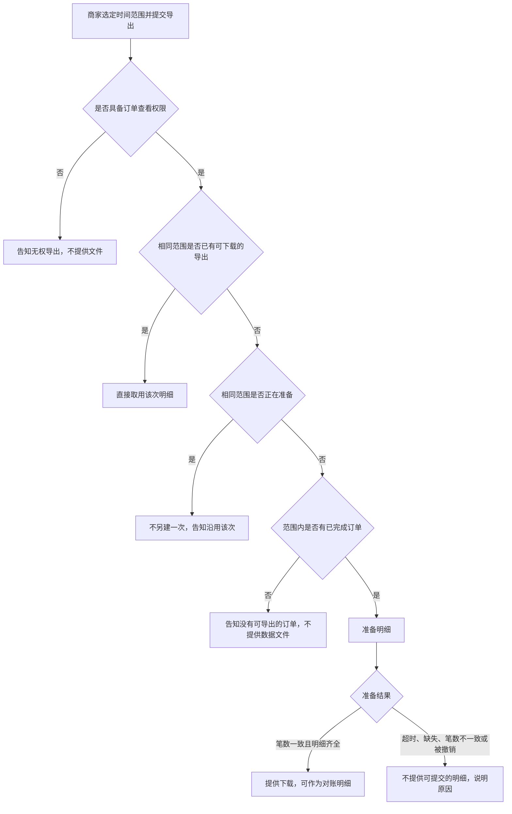

# 九段要求与示例

填写、补写或评审产品规格文档时对照本文件。先读对应段的「写什么」「写到位的标志」「常见写法」「勿写」，再按「格式」与「示例」落笔。示例中的接口、字段、状态码与仓库名只示范可核对密度，不是生产事实，不要抄进无关规格。

规格的用途，是让接到它的 Agent 知道下一步如何执行。故事与流程写业务步骤。功能规则、边界预期与验收在已经明确时写成可核对契约：API、字段、枚举、状态码、界面行为、事件 Schema、测试与发布检查项。部署手册与存储内部结构不作为故事或流程图的主体。

未知事项不得只写 `TBD` 三字。就地展开到下一 Agent 能继续，或写入规格包伴随文件并在主规格链接。没有责任人、期限与已掌握事实的 `TBD`，视为无人认领的空洞。

## 目录

- [文档包](#文档包)
- [1. 业务背景](#1-业务背景)
- [2. 用户故事](#2-用户故事)
- [3. 流程与路径](#3-流程与路径)
- [4. 功能清单](#4-功能清单)
- [5. 产品预期](#5-产品预期)
- [6. 边界与异常](#6-边界与异常)
- [7. 验收标准](#7-验收标准)
- [8. 术语表](#8-术语表)
- [9. 决策日志](#9-决策日志)

## 文档包

主规格始终是一份含九段标题的 `SPEC.md`。内容变长或尚未闭合时，细节可以外移，段标题不能外移。外移之后，主规格在对应段落给出相对规格包根目录的链接；链接目标不存在，视为该条仍是空洞。

推荐目录：

```text
<feature>-spec/
  SPEC.md
  tbd/<topic>.md
  assets/…
```

- `SPEC.md`：九段正文。标题使用「产品规格文档」的产出结构。
- `tbd/<topic>.md`：尚未闭合、但已写到足以让下一 Agent 继续的事项。文件开头写明它补哪一段、哪一条能力或验收、责任人、期限、已掌握事实、待决问题、禁止实现的假设，以及闭合后要改的契约。
- `assets/`：原型、演示与对照样例。产品预期用相对路径链接。

`TBD` 只有两种合格形态。

1. **就地展开。** 在规则或备注中写下已掌握事实、待决问题、标明为假设且禁止实现的默认、责任人、期限。下一 Agent 读完这一格就能知道哪一个字段还不能赋值、闭合后要补哪一条验收。
2. **伴随文件。** 主规格保留该能力的规则行与链接，例如 `[可下载期限](tbd/retention.md)`。九段标题仍留在 `SPEC.md`。不得因为细则移走而删掉某一段。

路径相对规格包根目录，不写技能仓库里的路径，不写易过时的源码路径。

## 1. 业务背景

### 写什么

业务背景说明为何实施、为何是此时，以及成功时哪一个业务结果可以被观察到。成功状态须能被验收引用：对照物、数量或时限至少有一项。未经验证的市场判断、竞品说法与内部立场分开标注。把尚未核对的句子写成事实，会使后续故事与验收建立在错误前提上。

### 写到位的标志

- Agent 能指出本期要改变的业务结果，以及用哪一个对照判断该结果已经发生。
- 已核对的约束与未验证的判断已经分开，没有依据的句子没有被写成事实。
- 成功状态能在验收中找到对应条目。

### 常见写法

先写谁必须在何时交出什么，再写现行做法为何达不到该窗口，然后写本期能力与成功时的对照关系。尚未核实的理由用「尚无证据，故不作为实施理由」收束。需要分开时使用短段落：现状与窗口、本期能力、成功状态、未采纳的理由。

### 勿写

- 以「体验更好」「赋能」「对齐行业」单独作为理由或成功定义。
- 用接口清单、存储方案或部署步骤代替业务结果。
- 把「用户都需要」「竞品均已支持」写成事实，而文中没有核对来源。

### 格式

连续段落。不要用功能表代替背景。

### 示例

商家须在每月前三个工作日向财务提交已完成订单的明细。目前只能逐单下载，往往无法在窗口关闭前交齐。本期提供按时间范围的一次导出，使具备订单查看权限的商家能够下载与筛选条件一致的明细。成功状态：对账窗口内，商家下载到的明细所含订单笔数，与订单列表在相同筛选下的已完成订单笔数一致。尚无证据表明竞品能力构成这些商家的主要缺口，故不把「竞品均已支持」写成实施理由。

## 2. 用户故事

### 写什么

用户故事用固定句式写出角色、场景、能力与价值。故事描述业务意图，供验收追溯。每条故事至少对应一条验收标准，使实现与测试有共同判据。角色是提出该需求或受该能力影响的人。

### 写到位的标志

- 句式四项都在：角色、场景、能力、价值。
- Agent 能从故事编号找到验收中的对应条目。
- 能力是使用者要完成的事。场景写清业务窗口或触发条件，Agent 能判断这条故事覆盖哪一条路径。

### 常见写法

`作为 [角色]，在 [场景] 下，需要 [能力]，以便 [价值]。`

编号列出。一条故事只承载一个意图。同一场景下的不同能力拆成多条，便于逐条对应验收。

### 勿写

- 角色写成「系统」，或能力写成「调用某某接口」。以系统为角色时，故事无法对应到可验收的使用意图。
- 在故事正文里写状态码、表结构、队列、部署或源码路径。这些属于功能规则、边界与验收；故事保持业务句式。
- 价值写成「以便系统更健壮」这类无法落到人的结果。

### 格式

有序列表。句式固定。在验收条目中回指故事编号。

### 示例

1. 作为商家运营，在月度对账需要交齐已完成订单明细时，需要按时间范围一次导出这些订单，以便在对账窗口内提交与列表笔数一致的明细。
2. 作为商家财务，在同一次对账中再次索取同一时间范围的明细时，需要得知已有导出是否仍可下载，以便在窗口内直接取用该次明细。

## 3. 流程与路径

### 写什么

流程与路径描述业务流程：业务动作、交接对象，以及在何种条件下走向哪一条分支。存在多个角色、多种状态或较多分支时，用 Mermaid 绘制。角色之间的交接用 `sequenceDiagram`，状态与条件分支用 `flowchart`。图中只保留业务步骤、交接与条件分支。图的作用是让人核对业务步骤是否成立。

每一条分支都要能在边界或验收中找到可核对的预期。图上写了分支、下文没有预期，Agent 就无法判断该路径如何实现。

### 写到位的标志

- Agent 能沿图走完主路径与每个分支，并指出边界表或验收中的对应行。
- 分支条件是业务条件：权限、订单是否已完成、是否已有可下载结果、准备是否失败。
- 没有停在「然后系统处理」的节点。

### 常见写法

先用一段话写出主路径与关键分支，再附 Mermaid。节点用业务语言，例如「告知无权导出，不提供文件」「直接取用该次明细」。

### 勿写

- 在图中写入接口路径、状态码、存储、队列、重试中间件或部署步骤。契约写在功能清单、边界与验收。
- 只有图，没有文字说明分支的业务含义。
- 用「系统处理」「后台完成」作为节点。

### 格式

一段叙述，加一个 Mermaid 代码块。

### 示例

商家选定时间范围并提交导出。不具备订单查看权限时，告知无权导出且不提供文件。具备权限时，若相同范围已有可下载的导出，直接取用该次；若该次仍在准备，不另建一次并告知沿用。范围内没有已完成订单时，告知没有可导出的订单，不提供数据文件。有已完成订单时准备明细：笔数一致且明细齐全则提供下载，并允许作为对账明细；超时、明细缺失、笔数不一致或被撤销时，不提供可提交的明细，并说明原因。



## 4. 功能清单

### 写什么

功能清单按能力列出可执行的业务规则，并标明对应的用户故事。规则写清作用在哪些实体、哪些状态、哪些筛选上，允许什么、禁止什么，结果如何被观察到。口号式能力不能指导下一步实现。

规则依赖已经与工程对齐的 API、字段或枚举时，在规则或备注中写明契约：模块、接口、字段、枚举、状态码。写到模块与契约层。源码路径会很快过时，不写进规格。尚未与工程对齐的设想不得写成既定契约；对齐前放在 `TBD`，并保持可继续。

`TBD` 使用[文档包](#文档包)的两种形态之一。就地展开的最小内容是：已掌握事实、待决问题、禁止实现的假设、责任人、期限。伴随文件则在备注中给出相对路径与同样的责任信息，规则行本身仍保留可观察的约束。

### 写到位的标志

- 每一条规则都能被验收引用：实体、状态、筛选、允许或禁止、可见结果都在。
- 已对齐的契约出现在规则或备注中。Agent 知道下一步落实哪一个接口或枚举。
- 每一条 `TBD` 都有责任人、期限，以及就地展开或伴随文件。主规格九段标题都在。
- 对应故事编号可追溯。

### 常见写法

规则用「仅当…；包含…；不得…；结果为…」。备注写已对齐契约，或写 `TBD` 链接。

已对齐契约的备注句式：`POST /merchant/orders/exports`；请求字段 `createdFrom`、`createdTo`；响应 `status` 取 `preparing | ready | failed`。已与工程对齐。

就地展开的句式（下列数字不是本示例的规则）：单次订单上限未定。已知：上限须允许与列表笔数对照。待决：上限整数。假设（禁止实现）：10000。责任人：商家产品。期限：2026-10-21。

伴随文件的句式：可下载天数未闭合。闭合前 `downloadableUntil` 保持 `null`，下载不因时间失效。详见 [tbd/retention.md](tbd/retention.md)。责任人：商家产品。期限：2026-10-21。

### 勿写

- 「支持灵活导出」「体验顺畅」「尽量覆盖」等无法观察的口号。
- 未与工程对齐就把设想中的路径或字段写成既定契约。
- 源码文件路径、大段实现代码、部署步骤、存储引擎选型。
- 只写 `TBD`，不写已知事实、待决问题、责任人与期限。
- 细则外移后删掉该能力行，或删掉九段中的某一标题。

### 格式

| 能力 | 业务规则 | 对应故事 | 备注（含契约与 TBD） |
|------|----------|----------|----------------------|

规则单元格写完整句子。一条能力一行；同一能力的多条约束用分号连接，便于验收引用。

### 示例

| 能力 | 业务规则 | 对应故事 | 备注（含契约与 TBD） |
|------|----------|----------|----------------------|
| 按时间范围导出已完成订单 | 仅包含 `Order.status = completed`、且 `createdAt` 落在请求范围内的订单。`createdFrom` 与 `createdTo` 为 `YYYY-MM-DD`，按 UTC 日历日包含两端：起始日 00:00:00Z 起，至结束日次日 00:00:00Z 之前。`POST /merchant/orders/exports` 在可新建时返回 202，响应含 `exportId` 与 `status: preparing`。到达 `ready` 且 `reconciliationReady = true` 时，`orderCount` 等于同一筛选下的列表笔数 | 故事 1 | 契约已与工程对齐。权限为 `orders.read`。CSV 列为 `orderId,createdAt,amount,currency,completedAt`。店铺取认证上下文，请求体不含 `shopId` |
| 沿用已有导出 | 同一店铺、相同 `createdFrom` 与 `createdTo`：已有 `preparing` 时不得新建，须返回该次；已有 `ready` 且 `downloadableUntil` 为 `null` 或晚于当前时间时不得新建，须返回该次。`failed` 不阻止新建 | 故事 2 | 可下载天数未闭合。闭合前 `downloadableUntil` 为 `null`。详见 [tbd/retention.md](tbd/retention.md)。责任人：商家产品。期限：2026-10-21 |
| 导出状态与禁止下载 | `ExportStatus` 仅 `preparing`、`ready`、`failed`。`preparing` 与 `failed` 禁止下载。`failed` 时资源上的 `error.code` 仅取 `incomplete_source`、`count_mismatch`、`preparation_timeout`、`cancelled`。`ready` 与 `failed` 无出边 | 故事 1 | 模块：商家订单导出。接口与摘自原型的状态迁移见第 7 节 Implementation Decisions |

## 5. 产品预期

### 写什么

产品预期写使用者获得该能力之后可观察的状态：拿到的文件、笔数、字段、状态标签或调用结果。存在用户界面时，附上原型或演示的相对路径，使预期能对照界面核对。没有用户界面时，写明调用方得到的效果，并将界面项标为不适用。

预期要让 Agent 能判断一次使用是否达成。功能清单写规则，本段写使用者最终能核对的结果；两段都写，避免规则没有落点。

### 写到位的标志

- 结果落在文件、笔数、字段、提示或调用返回上，至少一项可核对。
- 有界面时，`assets/` 或外部演示的相对路径可打开；无界面时已标明不适用，并写了调用方效果。
- 预期与功能清单、验收中的成功结果一致。

### 常见写法

一段写出入口、得到的结果、与哪份对照物一致，再给原型路径。无界面时写：界面不适用；调用方在成功时得到何种资源，失败时得到何种说明。

### 勿写

- 「用户感到方便」「体验提升」且没有可观察结果。
- 把部署说明或运维手册写在本段。
- 预期中的笔数、字段或提示与验收矛盾。

### 格式

连续段落。附件使用相对规格包的路径。

### 示例

商家在订单列表选定时间范围并确认导出后，能看到该次导出的状态标签。`ready` 且 `reconciliationReady = true` 时，下载到的 CSV 笔数与同一筛选下的已完成订单笔数一致，列为 `orderId,createdAt,amount,currency,completedAt`，并可作为对账明细。原型：`assets/export-entry.png`。

## 6. 边界与异常

### 写什么

边界与异常覆盖权限、空态、部分失败、超时、重复提交、撤销，以及结果与对照物不一致。每一行的预期行为必须与验收同级可核对，写出下列四类中足以判定通过或失败的那些：资源状态、调用返回（HTTP 状态与 `error.code`）、禁止的动作、使用者可见的提示。已知契约时写明状态码、枚举与提示文案。只列出情形、不写可核对行为，该路径仍是缺口。

流程中的每个分支都要在本表或验收中有一行。本表的文案与状态码就是测试断言的来源。

### 写到位的标志

- 每一行都能被测试照着判定，不依赖「看起来正常」。
- 禁止的动作与仍允许的后续动作写明。
- 提示文案确定到可以断言；同一 `error.code` 在本表、验收与界面预期中使用同一字符串。

### 常见写法

情形写前置条件。预期行为按顺序写：是否创建或迁移资源、HTTP 状态、`error.code`、`error.message` 或界面文案、禁止的操作。

句式：无 `orders.read` 时，`POST /merchant/orders/exports` 返回 403，`error.code` 为 `orders_read_forbidden`，`error.message` 为「当前账号无权导出订单」，响应不含 `exportId`。

错误体系统一为 `{ "error": { "code": "...", "message": "..." } }`。需要调用方沿用已有导出时，在错误体之外同时返回 `exportId`。

### 勿写

- 「妥善处理」「友好提示」「稍后重试即可」「系统自动恢复」，且没有状态、返回、禁止动作或可见文案。
- 只列情形，预期行为留空，或只写「返回错误」。
- 用内部重试次数、队列名或表名代替对外可观察结果。
- 同一情形在本表与验收中使用不同状态码或不同文案。

### 格式

| 情形 | 预期行为 |
|------|----------|

预期行为用完整句子，包含状态、返回、禁止动作或可见提示。

### 示例

| 情形 | 预期行为 |
|------|----------|
| 无 `orders.read` | `POST /merchant/orders/exports` 返回 403，`error.code = orders_read_forbidden`，`error.message` 为「当前账号无权导出订单」，响应无 `exportId`，不创建导出。界面展示同一文案 |
| `createdFrom` 晚于 `createdTo` | POST 返回 422，`error.code = invalid_range`，`error.message` 为「时间范围不合法」，不创建导出 |
| 范围内没有 `completed` 订单 | POST 返回 422，`error.code = no_completed_orders`，`error.message` 为「该范围内没有可导出的已完成订单」，不创建导出。界面展示同一文案 |
| 部分订单明细不可用 | 导出进入 `failed`，资源 `error.code = incomplete_source`，`unavailableOrderIds` 列出这些订单。`GET .../download` 返回 409，`error.code = export_failed`，`error.message` 为「本次导出未完成，不能下载」。界面展示「部分订单明细暂不可用，本次不能作为对账明细」及不可用笔数。禁止下载，禁止把该次标为可提交 |
| 自 `acceptedAt` 起 15 分钟仍为 `preparing` | 进入 `failed`，资源 `error.code = preparation_timeout`。下载返回 409 `export_failed`。界面展示「导出准备超时，请重新导出」。同一范围允许再次 POST |
| 相同范围已有 `preparing` | POST 返回 409，`error.code = export_in_progress`，`error.message` 为「已有相同范围的导出正在准备，请沿用该次」，并返回原 `exportId`。不新建 |
| 撤销 `preparing` | `POST /merchant/orders/exports/{exportId}/cancel` 返回 200，`status = failed`，资源 `error.code = cancelled`。其后下载返回 409 `export_failed`。界面展示「该次导出已撤销」。对 `ready` 或 `failed` 调用 cancel 返回 409，`error.code = export_not_cancellable`，`error.message` 为「仅准备中的导出可以撤销」，状态不变 |
| 结束时 `orderCount` 不等于 `expectedCount` | 进入 `failed`，资源 `error.code = count_mismatch`，响应同时给出 `orderCount` 与 `expectedCount`。下载返回 409 `export_failed`。界面展示「明细笔数与订单列表不一致，请稍后重试」。禁止把该文件作为可提交的对账明细 |
| `preparing` 时请求下载 | `GET /merchant/orders/exports/{exportId}/download` 返回 409，`error.code = export_not_ready`，`error.message` 为「明细尚未准备完成，请稍后下载」。不返回文件 |

## 7. 验收标准

### 写什么

验收标准判断本期是否做完。本节仍是九段中的一段，其下固定四个子节，顺序不得调换，也不得升为第十个顶层章节：

1. **可核对条目**（Acceptance Criteria）
2. **Implementation Decisions**
3. **Testing Decisions**
4. **Reviewer 对照检查**

可核对条目用编号列出。每一条在已知时点名具体 API、字段、枚举、状态码、界面行为、事件 Schema、测试覆盖或发布检查项。结果须能判定通过或失败。给定、当、则可以作为句子骨架，结果子句必须落到契约或可观察行为。只写抽象条件、不点名已知契约，Agent 无法执行下一步。

尚未闭合的条目按[文档包](#文档包)展开，不得写成「功能正常」。四个子节都要出现。某一子节确无已决内容时，写「本项暂无已决决定」，并写明尚未决定的是模块、测试范围还是审查表面；不要删除该子节。

Implementation Decisions 记录已经做出的实现决定：将新建或修改的模块、这些模块的接口、工程给出的技术澄清、架构决定、Schema 变更、API 契约、具体交互。写到模块与契约层。不写易过时的源码路径，不写可运行的演示代码。例外：原型里的状态机、reducer、schema 或类型形状比散文更精确地编码了决定时，可精简内联，并注明摘自原型；只保留决定本身。

Testing Decisions 只约束外部行为。写明怎样算一条合格测试、测哪些模块、仓库中可对照的既有测试主题。既有测试写模块与主题，不写源码路径。

Reviewer 对照检查列出审查本次变更时要打开的仓库与产品表面：API 行为、契约、界面、事件 Schema。使用本案真实仓库；没有仓库名时写产品表面，并标出仍须确认的仓库。

速度或体验若必须写入，同时给出可观察代理，例如时限、状态迁移与界面不抛异常。没有代理的感受词不能单独作为条目。

### 写到位的标志

- 每一条可核对条目都能独立判定通过或失败，并且在已知处点名了契约。
- 四个子节都在。Implementation Decisions 足以让下一 Agent 知道改哪些模块与哪份契约。
- Testing Decisions 约束的是外部可观察结果与模块，不断言私有实现。
- Reviewer 清单能被用来打开具体仓库或表面。
- 第 6 节中的状态码与文案在本节约得一致。

### 常见写法

可核对条目用编号列表。同一状态下的禁止操作使用子编号，使禁止动作与父条目绑在一起。

1. 导出 API 对已受理且仍在准备的请求保持 `status: preparing`。
2. `preparing` 不得下载。
   1. `GET /merchant/orders/exports/{exportId}/download` 返回 409 Conflict，`error.code` 为 `export_not_ready`，并返回对操作人员安全的 `error.message`。
3. 生产环境返回该枚举之前，契约仓库中的 `ExportStatus` 必须包含 `preparing`、`ready`、`failed`。

事件行为二选一，且必须写死一种：共享 Schema 支持该状态，或发布说明写明该状态不产生事件。选定之后，条目里只保留选定的那一种。

Implementation Decisions 用列表分模块、接口、字段与交互。Testing Decisions 用列表写合格测试、模块与既有测试主题。Reviewer 对照检查用仓库或表面的列表。

### 勿写

- 仅有「体验良好」「尽量快速」「用户满意」，且没有可观察代理。
- 整节只有不含契约的「给定…当…则…」，已知的 API、字段、枚举或状态码却没有出现。
- 把四个子节拆成第十段及以后的顶层章节。
- 源码路径、完整控制器实现、部署手册。
- 测试决定只写「提高覆盖率」，不写外部行为与模块。
- 原型片段保留成可运行演示，或未注明摘自原型。

### 格式

```markdown
## 7. 验收标准

### 可核对条目
1. …

### Implementation Decisions
- 模块：
- 接口与契约：
- 交互：

### Testing Decisions
- 合格测试：
- 模块：
- 既有可对照测试：

### Reviewer 对照检查
- …
```

子节标题保持上述用词。可核对条目的句子写完整，使单条可以交给测试。

### 示例

下列条目与第 4、6 节使用同一套教学契约。

#### 可核对条目

1. `POST /merchant/orders/exports` 在调用方具备 `orders.read`、范围合法、范围内存在 `completed` 订单、且没有相同范围的 `preparing` 或仍可沿用的 `ready` 时，返回 202，响应含 `exportId` 与 `status: preparing`。
2. `status` 为 `preparing` 时不得下载。
   1. `GET /merchant/orders/exports/{exportId}/download` 返回 409，`error.code` 为 `export_not_ready`，`error.message` 为「明细尚未准备完成，请稍后下载」。
3. 在生产环境返回 `preparing`、`ready`、`failed` 之前，`merchant-contracts` 的 OpenAPI 枚举 `ExportStatus` 必须包含这三项。
4. 依赖这些状态的客户端开始消费之前，生成的客户端类型必须包含这三项；未知状态不得导致界面抛异常。
5. 商家 Web 对三种 `status` 均渲染标签、tone 与提示，且不抛异常：`preparing` 为「明细准备中」、tone `neutral`；`ready` 为「可下载」、tone `success`，仅当 `reconciliationReady = true` 时提示「可提交为对账明细」；`failed` 为「导出未完成」、tone `danger`。
6. 共享事件 Schema `ExportStatusChanged` 的 `status` 使用 `ExportStatus`，并包含 `exportId` 与可空的 `error.code`。发布说明须写明本功能发出该事件。
7. 范围内有 3 笔 `completed` 订单且明细齐全时，导出到达 `ready` 后 `orderCount` 与 `expectedCount` 均为 3，`reconciliationReady` 为 true，`unavailableOrderIds` 为空。下载返回 200，CSV 表头为 `orderId,createdAt,amount,currency,completedAt`，数据行 3 行，且不含非 `completed` 订单。（故事 1）
8. 不具备 `orders.read` 时，POST 返回 403，`error.code = orders_read_forbidden`，`error.message` 为「当前账号无权导出订单」，响应无 `exportId`。
9. 相同店铺与相同日期范围已有 `preparing` 时，再次 POST 返回 409，`error.code = export_in_progress`，`exportId` 为已有那次，导出资源数不增加。（故事 2）
10. 相同范围已有 `ready` 且 `downloadableUntil` 为 `null` 时，再次 POST 返回 200 与原 `exportId`，不新建。（故事 2）
11. 范围内没有 `completed` 订单时，POST 返回 422，`error.code = no_completed_orders`，不创建导出。
12. 明细不全时资源为 `failed`，`error.code = incomplete_source`，`unavailableOrderIds` 非空；下载返回 409 `export_failed`。界面展示「部分订单明细暂不可用，本次不能作为对账明细」。
13. `acceptedAt` 起满 15 分钟仍为 `preparing` 时，资源变为 `failed`，`error.code = preparation_timeout`。其后同一范围允许再次 POST。
14. 对 `preparing` 调用 cancel 返回 200，`status = failed`，`error.code = cancelled`；其后下载返回 409 `export_failed`。对 `ready` 调用 cancel 返回 409 `export_not_cancellable`，状态保持 `ready`。
15. `orderCount` 不等于 `expectedCount` 时，资源为 `failed`，`error.code = count_mismatch`，两者都出现在 `GET /merchant/orders/exports/{exportId}` 的响应中。下载返回 409 `export_failed`。
16. 测试必须覆盖：取得 `preparing` 并拒绝下载；`ready` 文件行数与列表笔数一致；无权限时 403；重复 `preparing` 返回同一 `exportId`；第 6 节其余各行的状态码与文案。
17. PR 描述必须链接 Jira `MERCH-1842` 与 Confluence 页面「商家订单导出发布说明」。
18. 可下载天数在 [tbd/retention.md](tbd/retention.md) 闭合前：`downloadableUntil` 为 `null`，下载不因时间返回 410。禁止把该文件中的占位天数实现为规则。

#### Implementation Decisions

- 模块：商家订单导出（新建，负责受理、迁移、下载、撤销）；商家订单查询（既有，只读 `completed` 订单的计数与明细字段）；商家 Web 导出面板（修改标签、提示、下载与撤销）；`merchant-contracts`（`ExportStatus`、错误体、`ExportStatusChanged`）。
- 接口：`POST /merchant/orders/exports`；`GET /merchant/orders/exports/{exportId}`；`GET /merchant/orders/exports/{exportId}/download`；`POST /merchant/orders/exports/{exportId}/cancel`。
- 资源字段：`exportId`、`shopId`、`createdFrom`、`createdTo`、`status`、`orderCount`、`expectedCount`、`reconciliationReady`、`unavailableOrderIds`、`error.code`、`acceptedAt`、`downloadableUntil`。`shopId` 来自认证上下文。错误体为 `{ "error": { "code", "message" } }`；需要沿用已有导出时，同时返回 `exportId`。
- 交互：相同店铺与日期范围在 `preparing` 期间拒绝新建；`ready` 且未过期时返回已有 `exportId`；`failed` 不参与沿用。进入 `ready` 时 `reconciliationReady` 必须为 true。下载仅在该条件下返回 200；否则返回 409，`error.code = export_failed`。
- 摘自原型的状态迁移（只保留决定，不是可运行实现）：

```text
preparing → ready    当 reconciliationReady
preparing → failed   当 incomplete_source | count_mismatch | preparation_timeout | cancelled
ready 与 failed 无出边
```

#### Testing Decisions

- 合格测试只断言外部行为：HTTP 状态、`error.code`、`error.message`、`status`、文件行数、界面标签与提示。不断言作业调度、存储键或私有函数。
- 模块：商家订单导出 API；商家 Web 导出面板。
- 既有可对照测试：订单列表按 `status = completed` 与日期范围筛选的接口测试；订单读接口的 403 测试；Web 订单状态标签的渲染测试。

#### Reviewer 对照检查

- `izelzzz/merchant-api` 中导出接口的状态、错误码与下载行为
- `izelzzz/merchant-contracts` 中 `ExportStatus`、错误体与 `ExportStatusChanged`
- `izelzzz/merchant-web` 中导出状态的标签、tone 与提示
- `merchant-contracts` 中事件 Schema 是否已包含 `preparing`、`ready`、`failed`

## 8. 术语表

### 写什么

术语表只收录会约束故事、流程、功能规则或验收的领域词。每一行给出该词在本规格中的确切含义、不包括什么、以及枚举或判定边界。定义须短到可以抄进验收而不改含义。不约束上述任何一处的词不设行，以免术语表变成词典。

### 写到位的标志

- Agent 能用该行消解歧义：本规格里指什么、不指什么、取值停在哪里。
- 故事、规则与验收中的同一词可以回指到同一行。
- 没有为了「完整」而收录的泛词。

### 常见写法

含义一句。不包括用分号隔开。边界写枚举或判定式，例如 `status` 仅 `preparing | ready | failed`，且仅 `ready` 且 `reconciliationReady = true` 时可下载。

业务词如果对应已定契约，边界里写该契约的取值，避免故事里的「已完成」与验收里的 `completed` 各指一事。

### 勿写

- 词典式铺陈、近义词感受、与本案无关的行业常识。
- 「批量就是一次做很多」这类不排除、不设边界的句子。
- 用队列、存储引擎或部署方式代替业务边界。
- 收录不出现在故事、流程、规则或验收中的词。

### 格式

| 术语 | 在本规格中的含义 | 不包括 | 边界 |
|------|------------------|--------|------|

一行一词。含义控制在一句。

### 示例

| 术语 | 在本规格中的含义 | 不包括 | 边界 |
|------|------------------|--------|------|
| 已完成订单 | `Order.status = completed` 的订单 | `pending`；`cancelled`；`refunded`；任何非 `completed` | 与列表筛选 `status=completed` 同一枚举；导出文件不得写入其他状态 |
| 导出 | 一次导出请求及其 `ExportStatus` | 队列；对象存储；后台作业实现 | `preparing` 不可下载；`ready` 且 `reconciliationReady = true` 才可下载并作为对账明细；`failed` 不可下载且为终态 |
| 批量 | 同一店铺、同一日期范围内全部已完成订单的一次导出 | 跨店铺；未完成订单；把多次请求拼成一次 | 范围由 `createdFrom`、`createdTo` 按第 4 节的 UTC 日历日决定 |
| 沿用 | 不新建导出，返回已有 `exportId` | 复制文件；对 `failed` 自动重试 | 仅当已有 `preparing`，或 `ready` 且 `downloadableUntil` 为 `null` 或未到期 |
| 订单查看权限 | 调用导出接口所需的权限 `orders.read` | 财务角色名称本身；店铺管理员的其他权限 | 无 `orders.read` 时 POST 返回 403 `orders_read_forbidden`，不创建导出 |
| 对账窗口 | 每月前三个工作日，商家须在此期间提交明细 | 自然月的其余日期；下载接口的技术超时 | 窗口内故事 2 要求仍可取用的条件见 [tbd/retention.md](tbd/retention.md)；闭合前不得用占位天数截断下载 |

## 9. 决策日志

### 写什么

决策日志使规格保持为活文档。范围、流程、功能规则、边界或验收一旦变更，追加一条，写明时间、变更点、理由与决策人。正文随决策修订，变更本身留在日志中。只改正文、不留记录，实现与测试会对着过期文档工作。

变更点要让 Agent 知道哪些段落已经改写。理由写业务或契约上的取舍，使后来的读者能判断能否再改回去。

### 写到位的标志

- Agent 能看出当前正文相对上一版改了什么、为何改、谁决定。
- 日志中的变更能在正文对应段落找到。日志写了收窄，正文仍是旧范围，视为规格分裂，须先改到一致。
- 尚未决定的 `TBD` 没有被写成已经拍板的决策。

### 常见写法

四列表。新决定追加在表末。变更点点名受影响的故事、规则或验收编号。同一天的不同取舍分行记录。

### 勿写

- 只改正文，不追加日志。
- 理由写成「优化一下」「评审意见」。
- 把仍开放的 `TBD` 记成已决规则。
- 在日志中粘贴大段实现代码或源码路径。

### 格式

| 时间 | 变更点 | 理由 | 决策人 |
|------|--------|------|--------|

### 示例

| 时间 | 变更点 | 理由 | 决策人 |
|------|--------|------|--------|
| 2026-10-06 | 确立按时间范围一次导出订单明细 | 商家须在每月前三个工作日交齐明细，逐单下载无法在窗口内完成 | 商家产品负责人 |
| 2026-10-08 | 导出范围由全部状态改为仅 `completed`；故事、功能规则与验收同步收窄 | 对账只核已完成订单；纳入其他状态后，明细笔数无法与对账清单对照 | 商家产品负责人 |
| 2026-10-14 | 部分明细不可用时不再交付残缺文件；改为 `failed` / `incomplete_source` 并禁止下载。验收改为点名导出 API、`ExportStatus` 与错误码 | 残缺文件仍可能被当成已交齐的对账明细；状态与错误码不确定时，实现无法判定通过或失败 | 商家产品负责人 |
| 2026-10-14 | 准备超过 `acceptedAt` 起 15 分钟仍未完成则 `preparation_timeout` | 对账窗口内需要明确的失败，商家才能对同一范围重新导出 | 商家产品负责人；已与工程对齐 |
