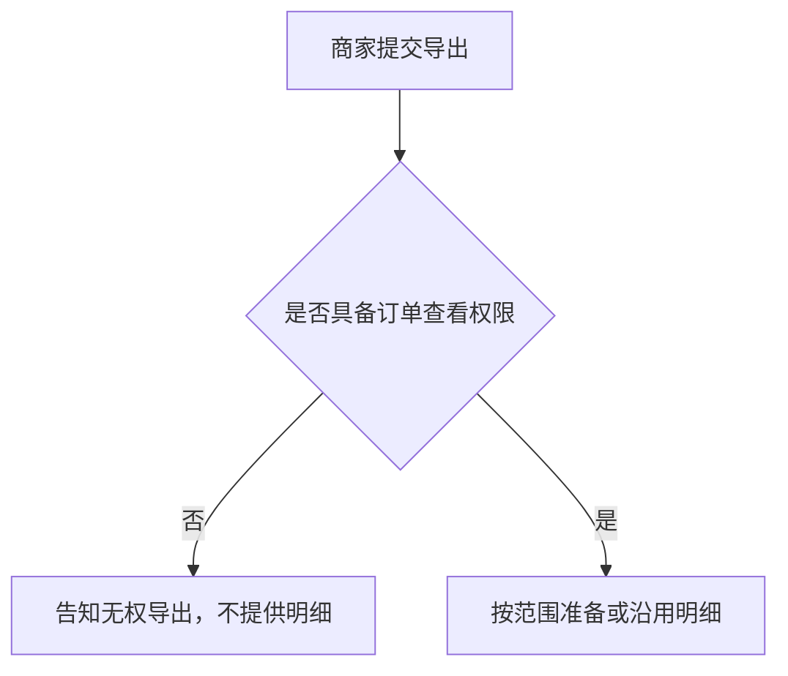

# 各段要求

填写、补写或评审前，先读该段的「写什么」「写到位的标志」「常见写法」「勿写」，再按「格式」与「示例」落笔。示例只示范详略。完整一篇见 [example.md](example.md)。不要把示例事实抄进无关规格。

全文用业务语言。接口、字段、枚举、状态码、事件、模块、仓库与测试断言属于 tech-spec。某段需要的事实缺失时，先检索已有上下文（当前对话、用户链接或给出的文档、仓库、既有规格）；仍缺则向用户提出短而具体的问题。不要默默留空，也不要用空白占位凑段。只有检索并询问之后用户仍无法确认，才在所属段标待确认：已掌握、待决、责任人、期限。不得只写「TBD」或「待定」，也不得为留白而留白。同一事实不在多段展开；验收指向边界，不逐条复述。

撰写与评审同时守住 SKILL.md 的「验证质量底线」：不编造规则、接口与未确认决策；缺事实先检索再询问；范围写明做什么与不做什么；已确认事实、假设与待确认分开；关键行为都有行为级验收或核对路径。具体 API 与字段不写入本规格。

## 目录

- [1. 业务目标](#1-业务目标)
- [2. 业务结构](#2-业务结构)
- [3. 用户故事](#3-用户故事)
- [4. 功能清单](#4-功能清单)
- [5. 边界与异常](#5-边界与异常)
- [6. 验收标准](#6-验收标准)
- [7. 术语表](#7-术语表)
- [8. 决策日志](#8-决策日志)

## 1. 业务目标

### 写什么

- 为何此时实施。
- 成功时可以观察的业务结果。对照物、数量或时限至少有一项。
- 已确认事实、假设与待确认分开写。待确认只在检索并询问后、用户仍无法确认时出现，并写明已掌握、待决、责任人与期限。

### 写到位的标志

- 能指出本期要改变的结果，以及用什么对照判断它已经发生。
- 假设与待确认没有写成已确认事实。
- 成功状态能被某一条验收引用。

### 常见写法

- 谁须在何时交出什么；现行做法为何达不到。
- 本期提供的能力，以及成功时的对照。
- 实施理由所依赖的事实缺失时，先检索再询问。检索与询问之后仍无证据，才收束为：尚无证据，故不作为实施理由。

### 勿写

- 只写「体验更好」或「赋能」。
- 用接口、存储或部署代替业务结果。
- 把无出处的「用户都需要」「竞品均已支持」写成事实。

### 格式

连续段落。不用功能表代替目标。

### 示例

商家须在每月前三个工作日向财务提交已完成订单的明细。目前只能逐单下载，往往无法在窗口关闭前交齐。本期提供按时间范围的一次导出。成功状态：对账窗口内，下载明细的订单笔数与订单列表在相同筛选下的已完成订单笔数一致。尚无证据表明竞品能力是主要缺口，故不把「竞品均已支持」写成实施理由。

## 2. 业务结构

### 写什么

- 角色、本期场景、包含与不包含。
- 依赖项（如有）：本期所依赖的上游系统、其他团队、前置条件或外部能力。没有则省略该行。不写接口或 Schema。
- 业务步骤、交接对象、条件分支。
- 多角色、多状态或多分支时附 Mermaid。图中只留业务步骤、角色交接与条件分支。

### 写到位的标志

- 能指出谁参与、本期做哪一段、不做什么。
- 有依赖时能指出上游系统、其他团队、前置条件或外部能力；没有则该行不出现，也不编造。
- 能沿叙述或图走完主路径与每个分支，并在边界中找到该分支的业务预期。
- 分支条件是业务条件，例如有无权限、是否已完成、是否已有可取用的结果。

### 常见写法

- 角色、场景、范围用短列表。有依赖时在同一列表写依赖项；没有则不出现该行。
- 路径先写一段主路径与分支，再附一图。
- 多角色交接且分支少时用 `sequenceDiagram`。状态与条件分支用 `flowchart`。不要两图重复同一路径。
- 节点用业务语言，例如「告知无权导出，不提供明细」。
- 有界面原型时，用一句话给出相对路径。没有则写「本期无单独原型」。

### 勿写

- 接口路径、字段、状态码、存储、队列、服务名、部署或源码路径。
- 把接口、字段或 Schema 写成依赖项。
- 只有图，没有分支的业务含义。
- 「系统处理」「后台完成」这类节点。
- 单角色、单路径、无分支时仍画图。

### 格式

角色、场景与范围用短列表：角色、场景、包含、不包含。有依赖时追加一行「依赖项（如有）」：上游系统、其他团队、前置条件或外部能力。没有则省略该行，不写「无」占位，也不编造。

流程与路径先写一段主路径与分支。多角色、多状态或多分支时，在段落后加一个 `flowchart` 或 `sequenceDiagram`。单路径且无分支时，省略图。

### 示例

- 角色：商家运营提交导出；商家财务在同一对账中再次取用。
- 场景：月度对账窗口内，按时间范围取得已完成订单明细。窗口外的历史查询不在本期。
- 包含：具备订单查看权限的一次导出；同范围已有进行中或仍可取用的导出时沿用。
- 不包含：未完成订单；无订单查看权限的账号。
- 依赖项（如有）：订单列表已能按「已完成」与时间范围给出可对照笔数；商家账号已具备可判定的订单查看权限。
- 本期无单独原型。

商家提交导出。无订单查看权限则告知无权，不提供明细；有权限则按范围准备或沿用。

## 3. 用户故事

### 写什么

- 用固定句式写角色、场景、能力、价值。一条故事一个意图。
- 每条至少对应一条验收。角色是人或岗位。

### 写到位的标志

- 四项都在：角色、场景、能力、价值。
- 能从故事编号找到验收条目。
- 能力是使用者要完成的事。场景写明业务窗口或触发条件。

### 常见写法

- `作为 [角色]，在 [场景] 下，需要 [能力]，以便 [价值]。`
- 编号列出。同一场景的不同意图拆条。

### 勿写

- 角色写成「系统」，或能力写成调用某个接口。
- 状态码、表结构、队列、部署或源码路径。
- 无法落到人的价值，例如「以便系统更健壮」。

### 格式

有序列表。句式固定。验收回指故事编号。

### 示例

1. 作为商家运营，在月度对账需要交齐已完成订单明细时，需要按时间范围一次导出这些订单，以便在对账窗口内提交与列表笔数一致的明细。

## 4. 功能清单

### 写什么

- 按能力列出业务规则，并标明对应故事。
- 规则写明对象、范围、允许或禁止、可观察结果。
- 未决写在备注：已掌握、待决、责任人、期限。先检索再询问；用户仍无法确认才写入。闭合前不把未决写成规则。

### 写到位的标志

- 每条规则能被验收或边界引用：对象、范围、允许或禁止、可见结果都在。
- 规则中没有路径、字段名、枚举名或状态码。
- 每条未决同时有已掌握事实、待决问题、责任人与期限。

### 常见写法

- 规则句式：仅当…；包含…；不得…；结果为…。一条能力一行。
- 备注句式：未决。已掌握：…。待决：…。责任人：…。期限：…。闭合前不把未决写成规则。

### 勿写

- 「支持灵活导出」等无法观察的口号。
- API、字段、枚举、状态码、事件名。
- 未检索、未询问就留空备注，或只写「TBD」，没有已掌握事实、待决问题、责任人与期限。
- 源码路径、实现步骤、部署或存储选型。

### 格式

| 能力 | 业务规则 | 对应故事 | 备注 |
|------|----------|----------|------|

### 示例

| 能力 | 业务规则 | 对应故事 | 备注 |
|------|----------|----------|------|
| 沿用已有导出 | 同一店铺、相同时间范围：已有进行中的导出，或已成功且仍可取用的导出，不得另建，须沿用该次。已失败的导出不阻止新建 | 故事 2 | |
| 可取用期限 | 成功导出后，商家在当月对账窗口内须仍能取用该次明细 | 故事 2 | 未决。已掌握：至少覆盖当月对账窗口剩余工作日。待决：窗口结束后是否仍可取用，以及可取用天数。责任人：商家产品。期限：2026-10-21。闭合前不把任一具体天数写成规则 |

## 5. 边界与异常

### 写什么

- 覆盖流程中的每个分支：权限、空态、重复提交、失败、超时、撤销，以及结果与对照物不一致。
- 每行写可观察的业务预期：是否提供所需结果、告知什么、还允许做什么。

### 写到位的标志

- 每一行都能按业务结果判定通过或失败。
- 禁止的动作与仍允许的后续动作已经写明。
- 流程图里的每个分支在本表有一行，或明确落入某一行。

### 常见写法

- 情形写前置条件。预期按序写：是否另建或提供结果、告知的内容、禁止的动作。
- 业务预期相同的情形可以同行。告知内容或允许的后续动作不同则另起行。

### 勿写

- 「妥善处理」「友好提示」，且没有可见结果。
- 只列情形，预期为空，或只写「返回错误」。预期未知时先检索再询问，不要留空单元格；仍无法确认则在该行写下已掌握、待决、责任人与期限。
- 状态码、错误码、字段名、内部重试次数、队列名或表名。
- 把本表在验收里再抄一遍。

### 格式

| 情形 | 业务预期 |
|------|----------|

### 示例

| 情形 | 业务预期 |
|------|----------|
| 无订单查看权限 | 告知无权导出，不提供明细 |
| 相同范围已有进行中的导出 | 不另建，告知沿用该次 |

## 6. 验收标准

### 写什么

- 成功路径写成行为合同：谁在什么条件下看到什么结果。
- 每条用户故事至少一条验收，并回指故事编号。
- 第 5 节已经写下的情形，用一句话指向该表，不逐条复述。

### 写到位的标志

- 每条成功路径能独立判定通过或失败。
- 流程与规则中的每个关键行为，都能在本段或第 5 节找到行为级验收或核对路径。
- 结果是人可以观察的，并且与业务目标中的成功状态一致。
- 边界情形只在第 5 节展开一处。

### 常见写法

- 句式：`<角色>` 在 `<条件>` 下 `<动作>` 后，得到 `<可观察结果>`。
- 编号列出。末条固定指向边界：第 5 节各情形的业务预期即为该情形的验收。
- 验收所需的行为结果尚缺时，先检索上下文再向用户提问。用户仍无法确认时，写明缺的是哪一种行为结果，并记下已掌握、待决、责任人与期限。不要补造规则，也不要留空条目。

### 勿写

- API、字段、枚举、状态码、事件 Schema、测试用例或发布检查项。
- 把第 5 节每一行改写成一条验收。
- 只写「功能正常」「体验良好」，且没有可观察结果。

### 格式

编号列表。每条一个完整句子。最后一条指向第 5 节。

### 示例

1. 具备订单查看权限的商家，在范围内存在已完成订单、且没有相同范围的进行中或仍可取用导出时，提交一次导出后得到一份明细。该明细只含已完成订单，笔数与同一时间范围下订单列表的已完成订单笔数一致。（故事 1）
2. 第 5 节各情形的业务预期即为该情形的验收。此处不逐条复述。

## 7. 术语表

### 写什么

- 只收录会约束故事、流程、规则或验收的词。
- 每行写本规格中的含义、不包括什么、判定停在哪里。
- 定义短到可以抄进验收而不改含义。

### 写到位的标志

- 能用该行消解歧义：本规格里指什么、不指什么、取值停在哪里。
- 故事、规则与验收中的同一词回指同一行。
- 没有为了凑数而收录的泛词。

### 常见写法

- 一行一词。含义一句。不包括用分号隔开。
- 边界用业务判定，例如与订单列表中的某个筛选为同一含义。

### 勿写

- 词典式铺陈，或与本案无关的行业常识。
- 不排除、不设边界的句子，例如「批量就是一次做很多」。
- 用字段名、枚举、状态码、队列或存储充当边界。
- 收录不出现在故事、流程、规则或验收中的词。

### 格式

| 术语 | 在本规格中的含义 | 不包括 | 边界 |
|------|------------------|--------|------|

### 示例

| 术语 | 在本规格中的含义 | 不包括 | 边界 |
|------|------------------|--------|------|
| 已完成订单 | 已完结、可纳入对账清单的订单 | 未完结的订单 | 与订单列表中「已完成」为同一含义 |
| 沿用 | 不另建导出，取用已有的同范围明细 | 对已失败的导出自动重做 | 已有进行中的导出，或已成功且仍可取用的导出 |

## 8. 决策日志

### 写什么

- 范围、流程、规则、边界或验收变更时，先追加一行，再改正文。
- 变更点点名受影响的故事、规则或验收。理由写业务取舍。
- 决策人是做出产品决定的角色。

### 写到位的标志

- 能看出相对上一版改了什么、为何改、谁决定。
- 日志中的变更在正文对应段落找得到，且范围一致。
- 未闭合的未决没有被写成已决规则。

### 常见写法

- 四列表。新决定追加在表末。同一天的不同取舍分行。

### 勿写

- 只改正文，不追加日志。
- 理由写成「优化一下」或「评审意见」。
- 把仍开放的未决记成已决。
- 实现取舍、接口变更、测试范围。此类记入 tech-spec 的技术决策日志。

### 格式

| 时间 | 变更点 | 理由 | 决策人 |
|------|--------|------|--------|

### 示例

| 时间 | 变更点 | 理由 | 决策人 |
|------|--------|------|--------|
| 2026-10-08 | 导出范围由全部订单改为仅已完成订单；故事、规则与验收同步收窄 | 对账只核已完成订单，其他状态无法与对账清单对照笔数 | 商家产品负责人 |
