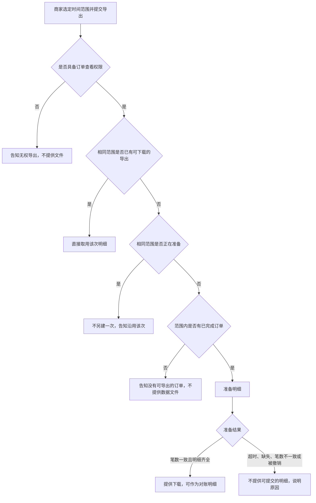

# 九段要求与示例

填写、补写或评审前，先读该段的「写什么」「写到位的标志」「常见写法」「勿写」，再按「格式」与「示例」落笔。示例中的接口、字段、状态码与仓库名只示范密度，不要抄进无关规格。

故事/流程=业务；规则·边界·验收=已知契约。

## 目录

- [文档包](#文档包)
- [1. 业务背景](#1-业务背景)
- [2. 用户故事](#2-用户故事)
- [3. 流程与路径](#3-流程与路径)
- [4. 功能清单](#4-功能清单)
- [5. 产品预期](#5-产品预期)
- [6. 边界与异常](#6-边界与异常)
- [7. 验收标准](#7-验收标准)
- [8. 术语表](#8-术语表)
- [9. 决策日志](#9-决策日志)

## 文档包

主规格是一份九段都在的 `SPEC.md`。细则可外移，段标题不可外移。链接相对规格包根目录；目标不存在则该条仍是空洞。不写源码路径。

```text
<feature>-spec/
  SPEC.md
  tbd/<topic>.md
  assets/…
```

- `SPEC.md`：九段正文。
- `tbd/<topic>.md`：未闭合事项。开头写明补哪一段、责任人、期限、已掌握事实、待决问题、禁止实现的假设、闭合后要改的契约。
- `assets/`：原型与演示。产品预期用相对路径链接。

`TBD` 二选一：就地写已掌握事实、待决问题、禁止实现的假设、责任人与期限；或保留规则行并链接 `tbd/<topic>.md`。不得只写 `TBD` 三字，不得删段。

## 1. 业务背景

### 写什么

- 写明为何此时实施，以及成功时可观察的业务结果；对照物、数量或时限至少有一项。
- 已核对的约束与未验证的判断分开写；无依据的句子不得写成事实。
- 成功状态须能被第 7 节的一条验收引用。

### 写到位的标志

- 能指出本期要改变的业务结果，以及用哪一个对照判断已经发生。
- 未验证的判断没有被写成事实。
- 成功状态在验收中有对应条目。

### 常见写法

- 句式：谁须在何时交出什么；现行做法为何达不到；本期能力；成功时的对照。
- 未核实的理由收束为：尚无证据，故不作为实施理由。

### 勿写

- 仅以「体验更好」「赋能」作为理由或成功定义。
- 用接口、存储或部署代替业务结果。
- 把无出处的「用户都需要」「竞品均已支持」写成事实。

### 格式

连续段落。不用功能表代替背景。

### 示例

商家须在每月前三个工作日向财务提交已完成订单的明细。目前只能逐单下载，往往无法在窗口关闭前交齐。本期提供按时间范围的一次导出，使具备订单查看权限的商家下载与筛选条件一致的明细。成功状态：对账窗口内，下载明细的订单笔数与订单列表在相同筛选下的已完成订单笔数一致。尚无证据表明竞品能力是主要缺口，故不把「竞品均已支持」写成实施理由。

## 2. 用户故事

### 写什么

- 用固定句式写角色、场景、能力、价值。一条故事一个意图。
- 每条至少对应第 7 节一条验收。角色是人或岗位，不是「系统」。

### 写到位的标志

- 四项都在：角色、场景、能力、价值。
- 能从故事编号找到验收条目。
- 能力是使用者要完成的事；场景写明业务窗口或触发条件。

### 常见写法

- `作为 [角色]，在 [场景] 下，需要 [能力]，以便 [价值]。`
- 编号列出。同一场景的不同能力拆条。

### 勿写

- 角色写成「系统」，或能力写成「调用某某接口」。
- 正文写状态码、表结构、队列、部署或源码路径。
- 价值写成无法落到人的结果，如「以便系统更健壮」。

### 格式

有序列表。句式固定。验收回指故事编号。

### 示例

1. 作为商家运营，在月度对账需要交齐已完成订单明细时，需要按时间范围一次导出这些订单，以便在对账窗口内提交与列表笔数一致的明细。
2. 作为商家财务，在同一次对账中再次索取同一时间范围的明细时，需要得知已有导出是否仍可下载，以便在窗口内直接取用该次明细。

## 3. 流程与路径

### 写什么

- 写业务步骤、交接对象、条件分支。
- 多角色用 `sequenceDiagram`，状态与分支用 `flowchart`。图中只留业务步骤、交接与条件分支。
- 每个分支在第 6 节或第 7 节有可核对预期。

### 写到位的标志

- 能沿图走完主路径与每个分支，并指出边界或验收中的对应行。
- 分支条件是业务条件：权限、是否已完成、是否已有可下载结果、准备是否失败。
- 没有「然后系统处理」这类节点。

### 常见写法

- 先用一段写出主路径与关键分支，再附 Mermaid。
- 节点用业务语言，如「告知无权导出，不提供文件」。

### 勿写

- 图中写接口路径、状态码、存储、队列或部署。
- 只有图，没有分支的业务含义。
- 用「系统处理」「后台完成」作节点。

### 格式

一段叙述，加一个 Mermaid 代码块。

### 示例

商家选定时间范围并提交导出。无订单查看权限则告知无权、不提供文件。有权限时：已有可下载的同范围导出则直接取用；仍在准备则不另建并告知沿用。范围内无已完成订单则告知无可导出、不提供数据文件。有则准备明细：笔数一致且齐全则提供下载；超时、缺失、笔数不一致或被撤销则不提供可提交明细并说明原因。



## 4. 功能清单

### 写什么

- 按能力列出业务规则，并标明对应故事。规则写明实体、状态、筛选、允许或禁止、可观察结果。
- 已与工程对齐的 API、字段、枚举、状态码写入规则或备注。未对齐的按[文档包](#文档包)做 `TBD`，不写成既定契约。
- 不写源码路径。细则外移后仍保留该能力行与九段标题。

### 写到位的标志

- 每条规则能被验收引用：实体、状态、筛选、允许或禁止、可见结果都在。
- 已对齐契约出现在规则或备注中。
- 每条 `TBD` 有责任人、期限，以及就地展开或伴随文件。对应故事编号可追溯。

### 常见写法

- 规则句式：仅当…；包含…；不得…；结果为…。一条能力一行，多条约束用分号连接。
- 已对齐备注：`POST /merchant/orders/exports`；字段 `createdFrom`、`createdTo`；`status` 取 `preparing | ready | failed`。
- 就地：已知…；待决…；假设（禁止实现）…；责任人…；期限…。伴随文件：详见 `tbd/<topic>.md`，并写责任人与期限。

### 勿写

- 「支持灵活导出」等无法观察的口号。
- 未对齐就把设想路径或字段写成既定契约。
- 源码路径、大段实现、部署步骤、存储选型。
- 只写 `TBD`，没有已知事实、待决问题、责任人与期限。
- 细则外移后删掉该能力行或某一段标题。

### 格式

一条能力一行。规则写完整句子。

| 能力 | 业务规则 | 对应故事 | 备注（含契约与 TBD） |
|------|----------|----------|----------------------|

### 示例

第 1 行是已对齐契约，第 2 行是伴随文件。表内链接指向本仓库副本；写入规格包时改为 `tbd/retention.md`。

| 能力 | 业务规则 | 对应故事 | 备注（含契约与 TBD） |
|------|----------|----------|----------------------|
| 按时间范围导出已完成订单 | 仅含 `Order.status = completed` 且 `createdAt` 落在范围内的订单。`createdFrom`、`createdTo` 为 `YYYY-MM-DD`，UTC 日历日含两端。可新建时 `POST /merchant/orders/exports` 返回 202，响应含 `exportId` 与 `status: preparing`。`ready` 且 `reconciliationReady = true` 时，`orderCount` 等于同一筛选的列表笔数 | 故事 1 | 已与工程对齐。权限 `orders.read`。CSV 列 `orderId,createdAt,amount,currency,completedAt`。`shopId` 取认证上下文，请求体不含该字段 |
| 沿用已有导出 | 同一店铺、相同 `createdFrom` 与 `createdTo`：已有 `preparing`，或 `ready` 且 `downloadableUntil` 为 `null` 或未到期，不得新建，须返回该次。`failed` 不阻止新建 | 故事 2 | 可下载天数未闭合。闭合前 `downloadableUntil` 为 `null`。详见 [tbd/retention.md](example-package/tbd/retention.md)。责任人：商家产品。期限：2026-10-21 |
| 导出状态 | `ExportStatus` 仅 `preparing`、`ready`、`failed`。`preparing` 与 `failed` 禁止下载。`ready` 与 `failed` 无出边 | 故事 1 | 模块：商家订单导出。状态迁移见第 7 节 |

## 5. 产品预期

### 写什么

- 写使用者可观察的结果：文件、笔数、字段、状态标签或调用返回。
- 有界面则附 `assets/` 相对路径；无界面则写调用方效果，并标明界面不适用。

### 写到位的标志

- 至少一项结果可核对。
- 有界面时路径可打开；无界面时已标明不适用。
- 与功能清单、验收中的成功结果一致。

### 常见写法

- 一段写出入口、得到的结果、对照物、原型路径。
- 无界面时写：界面不适用；成功时调用方得到何种资源，失败时得到何种说明。

### 勿写

- 只有「方便」「体验提升」，没有可观察结果。
- 部署或运维手册。
- 笔数、字段或提示与验收矛盾。

### 格式

连续段落。附件使用相对规格包的路径。

### 示例

商家在订单列表选定时间范围并确认导出后，能看到该次导出的状态标签。`ready` 且 `reconciliationReady = true` 时，下载到的 CSV 笔数与同一筛选下的已完成订单笔数一致，列为 `orderId,createdAt,amount,currency,completedAt`，并可作为对账明细。原型：`assets/export-entry.png`。

## 6. 边界与异常

### 写什么

- 覆盖权限、空态、部分失败、超时、重复提交、撤销，以及结果与对照物不一致。流程中的每个分支须在本表或第 7 节有可核对预期。
- 每行写出足以判定通过或失败的项：资源状态、HTTP 状态与 `error.code`、禁止的动作、可见提示。已知时写明状态码、枚举与文案。
- 同一 `error.code` 在本表、验收与界面预期中使用同一字符串。

### 写到位的标志

- 每一行都能被测试照着判定。
- 禁止的动作与仍允许的后续动作已写明。
- 提示文案确定到可以断言。

### 常见写法

- 情形写前置条件。预期按序写：是否创建或迁移、HTTP 状态、`error.code`、文案、禁止的操作。
- 错误体：`{ "error": { "code", "message" } }`。需沿用已有导出时同时返回 `exportId`。
- 下载契约相同的失败码可以同行；状态码或禁止动作不同则另起行。

### 勿写

- 「妥善处理」「友好提示」「稍后重试即可」，且没有状态、返回、禁止动作或可见文案。
- 只列情形，预期为空，或只写「返回错误」。
- 用内部重试次数、队列名或表名代替对外结果。
- 同一情形在本表与验收中使用不同状态码或文案。

### 格式

预期行为用完整句子。

| 情形 | 预期行为 |
|------|----------|

### 示例

五行分别示范 403、空态、冲突沿用、失败后禁止下载、撤销。

| 情形 | 预期行为 |
|------|----------|
| 无 `orders.read` | `POST /merchant/orders/exports` 返回 403，`error.code = orders_read_forbidden`，`error.message` 为「当前账号无权导出订单」，无 `exportId`，不创建导出 |
| 范围内无 `completed` 订单 | POST 返回 422，`error.code = no_completed_orders`，`error.message` 为「该范围内没有可导出的已完成订单」，不创建导出 |
| 相同范围已有可沿用导出 | 已有 `preparing`：POST 返回 409，`error.code = export_in_progress`，返回原 `exportId`，文案「已有相同范围的导出正在准备，请沿用该次」，不新建。已有 `ready` 且 `downloadableUntil` 为 `null` 或未到期：返回 200 与原 `exportId`，不新建 |
| 准备失败后下载 | 进入 `failed` 后 `GET /merchant/orders/exports/{exportId}/download` 返回 409，`error.code = export_failed`，`error.message` 为「本次导出未完成，不能下载」，不返回文件。资源 `error.code`：明细缺失为 `incomplete_source`，笔数不一致为 `count_mismatch`，自 `acceptedAt` 起 15 分钟仍 `preparing` 为 `preparation_timeout` |
| 撤销 `preparing` | `POST /merchant/orders/exports/{exportId}/cancel` 返回 200，`status = failed`，资源 `error.code = cancelled`。对 `ready` 或 `failed` 调用 cancel 返回 409，`error.code = export_not_cancellable`，`error.message` 为「仅准备中的导出可以撤销」，状态不变 |

## 7. 验收标准

### 写什么

- 保持为一段。四个子节按顺序都要出现，不得升为第十段：可核对条目、Implementation Decisions、Testing Decisions、Reviewer 对照检查。无已决内容时写「本项暂无已决决定」，并写明未决的是模块、测试范围还是审查表面。
- 可核对条目编号列出。已知时点名 API、字段、枚举、状态码、界面行为、事件 Schema、测试或发布检查项。与第 6 节相同的码与文案指向该行。未闭合条目按[文档包](#文档包)展开，不得写成「功能正常」。
- Implementation Decisions 写模块、接口、Schema、API 契约与交互，不写源码路径；原型里的状态机或类型仅在比散文更精确时精简内联，并注明摘自原型。Testing Decisions 只写外部行为、被测模块与既有测试主题。Reviewer 对照检查列出要打开的仓库或产品表面；没有仓库名时写产品表面，并标出仍须确认的仓库。

### 写到位的标志

- 每条可核对条目能独立判定通过或失败，并在已知处点名了契约。
- 四个子节都在；Implementation Decisions 写明模块与契约。
- Testing Decisions 不断言私有实现。
- Reviewer 清单能打开具体仓库或表面；与第 6 节的状态码、文案一致。

### 常见写法

- 编号列表。同一状态下的禁止操作用子编号。
- 事件写死一种：共享 Schema 含该状态，或发布说明写明不产生该事件。
- 速度或体验若写入，同时给出可观察代理：时限、状态迁移，或界面不抛异常。

### 勿写

- 仅有「体验良好」「尽量快速」，且无可观察代理。
- 已知契约却只写不含 API、字段、枚举或状态码的给定/当/则。
- 把四个子节拆成第十段及以后。
- 源码路径、完整实现、部署手册；未注明摘自原型的可运行片段。
- 测试决定只写「提高覆盖率」。

### 格式

第 7 节一段；子节标题用下列用词。可核对条目写完整句子。

```markdown
## 7. 验收标准

### 可核对条目
1. …

### Implementation Decisions
- 模块：
- 接口与契约：
- 交互：

### Testing Decisions
- 合格测试：
- 模块：
- 既有可对照测试：

### Reviewer 对照检查
- …
```

### 示例

与第 6 节重复的状态码不在此逐条重列。

#### 可核对条目

1. `POST /merchant/orders/exports` 在具备 `orders.read`、范围合法、范围内存在 `completed` 订单、且没有相同范围的 `preparing` 或仍可沿用的 `ready` 时，返回 202，响应含 `exportId` 与 `status: preparing`。
2. `status` 为 `preparing` 时不得下载。
   1. `GET /merchant/orders/exports/{exportId}/download` 返回 409，`error.code = export_not_ready`，`error.message` 为「明细尚未准备完成，请稍后下载」。
3. 生产环境返回 `preparing`、`ready`、`failed` 之前，`merchant-contracts` 的 OpenAPI 枚举 `ExportStatus` 必须包含这三项；生成的客户端类型必须包含这三项。未知状态不得导致界面抛异常。
4. 商家 Web 对三种 `status` 渲染标签与 tone，且不抛异常：`preparing`「明细准备中」/`neutral`；`ready`「可下载」/`success`，仅 `reconciliationReady = true` 时提示「可提交为对账明细」；`failed`「导出未完成」/`danger`。
5. 事件 `ExportStatusChanged` 的 `status` 使用 `ExportStatus`，并含 `exportId` 与可空 `error.code`。发布说明写明本功能发出该事件。
6. 范围内 3 笔 `completed` 且明细齐全时，到达 `ready` 后 `orderCount` 与 `expectedCount` 均为 3，`reconciliationReady = true`。下载返回 200，CSV 表头 `orderId,createdAt,amount,currency,completedAt`，数据行 3 行，且不含非 `completed` 订单。（故事 1）
7. 第 6 节每一行的状态码、`error.code` 与文案均为验收条件。故事 2 的沿用以「相同范围已有可沿用导出」行为准。
8. [tbd/retention.md](example-package/tbd/retention.md) 闭合前，`downloadableUntil` 为 `null`，下载不因时间返回 410。禁止把该文件中的占位天数实现为规则。

#### Implementation Decisions

- 模块：商家订单导出（新建：受理、迁移、下载、撤销）；商家订单查询（既有，只读 `completed` 的计数与明细）；商家 Web 导出面板（标签、提示、下载、撤销）；`merchant-contracts`（`ExportStatus`、错误体、`ExportStatusChanged`）。
- 接口：`POST /merchant/orders/exports`；`GET /merchant/orders/exports/{exportId}`；`GET /merchant/orders/exports/{exportId}/download`；`POST /merchant/orders/exports/{exportId}/cancel`。
- 资源字段：`exportId`、`shopId`（认证上下文）、`createdFrom`、`createdTo`、`status`、`orderCount`、`expectedCount`、`reconciliationReady`、`unavailableOrderIds`、`error.code`、`acceptedAt`、`downloadableUntil`。错误体 `{ "error": { "code", "message" } }`；沿用时同时返回 `exportId`。
- 交互：`preparing` 期间拒绝新建；`ready` 且未过期返回已有 `exportId`；`failed` 不参与沿用。进入 `ready` 时 `reconciliationReady` 为 true。仅此时下载返回 200。`preparing` 下载返回 409 `export_not_ready`；`failed` 下载返回 409 `export_failed`。
- 摘自原型的状态迁移（只保留决定）：

```text
preparing → ready    当 reconciliationReady
preparing → failed   当 incomplete_source | count_mismatch | preparation_timeout | cancelled
ready 与 failed 无出边
```

#### Testing Decisions

- 合格测试只断言外部行为：HTTP 状态、`error.code`、`error.message`、`status`、文件行数、界面标签。不断言调度、存储键或私有函数。
- 模块：商家订单导出 API；商家 Web 导出面板。
- 既有可对照测试：订单列表按 `status = completed` 与日期范围筛选；订单读接口的 403；Web 订单状态标签。
- 发布检查：PR 描述链接本案工单与发布说明。

#### Reviewer 对照检查

- `izelzzz/merchant-api`：导出的状态、错误码与下载
- `izelzzz/merchant-contracts`：`ExportStatus`、错误体、`ExportStatusChanged` 是否包含 `preparing`、`ready`、`failed`
- `izelzzz/merchant-web`：导出状态的标签、tone 与提示

## 8. 术语表

### 写什么

- 只收录会约束故事、流程、规则或验收的词。
- 每行写本规格中的含义、不包括什么、枚举或判定边界。定义短到可以抄进验收而不改含义。

### 写到位的标志

- 能用该行消解歧义：本规格里指什么、不指什么、取值停在哪里。
- 故事、规则与验收中的同一词回指同一行。
- 没有为了凑数而收录的泛词。

### 常见写法

- 一行一词。含义一句。不包括用分号隔开。边界写枚举或判定式。
- 业务词若已有契约，边界写该契约的取值。

### 勿写

- 词典式铺陈，或与本案无关的行业常识。
- 不排除、不设边界的句子，如「批量就是一次做很多」。
- 用队列、存储或部署代替业务边界。
- 收录不出现在故事、流程、规则或验收中的词。

### 格式

一行一词。含义控制在一句。

| 术语 | 在本规格中的含义 | 不包括 | 边界 |
|------|------------------|--------|------|

### 示例

| 术语 | 在本规格中的含义 | 不包括 | 边界 |
|------|------------------|--------|------|
| 已完成订单 | `Order.status = completed` 的订单 | 任何非 `completed` | 与列表筛选同一枚举 |
| 导出 | 一次导出请求及其 `ExportStatus` | 队列、存储与作业实现 | 仅 `ready` 且 `reconciliationReady = true` 可下载 |
| 沿用 | 不新建导出，返回已有 `exportId` | 对 `failed` 自动重试 | 已有 `preparing`，或 `ready` 且未过可下载期限 |
| 对账窗口 | 每月前三个工作日 | 其余日期；下载接口超时 | 窗口内仍可取用的天数见第 4 节备注 |

## 9. 决策日志

### 写什么

- 范围、流程、规则、边界或验收变更时，先追加一行，再改正文。
- 变更点点名受影响的故事、规则或验收；理由写业务或契约上的取舍。

### 写到位的标志

- 能看出相对上一版改了什么、为何改、谁决定。
- 日志中的变更在正文对应段落找得到，且范围一致。
- 未闭合的 `TBD` 没有被写成已决规则。

### 常见写法

- 四列表。新决定追加在表末。同一天的不同取舍分行。

### 勿写

- 只改正文，不追加日志。
- 理由写成「优化一下」或「评审意见」。
- 把仍开放的 `TBD` 记成已决。
- 粘贴实现代码或源码路径。

### 格式

新决定追加在表末。

| 时间 | 变更点 | 理由 | 决策人 |
|------|--------|------|--------|

### 示例

| 时间 | 变更点 | 理由 | 决策人 |
|------|--------|------|--------|
| 2026-10-06 | 确立按时间范围一次导出订单明细 | 商家须在每月前三个工作日交齐明细，逐单下载无法在窗口内完成 | 商家产品负责人 |
| 2026-10-08 | 导出范围由全部状态改为仅 `completed`；故事、规则与验收同步收窄 | 对账只核已完成订单，其他状态无法与对账清单对照笔数 | 商家产品负责人 |
