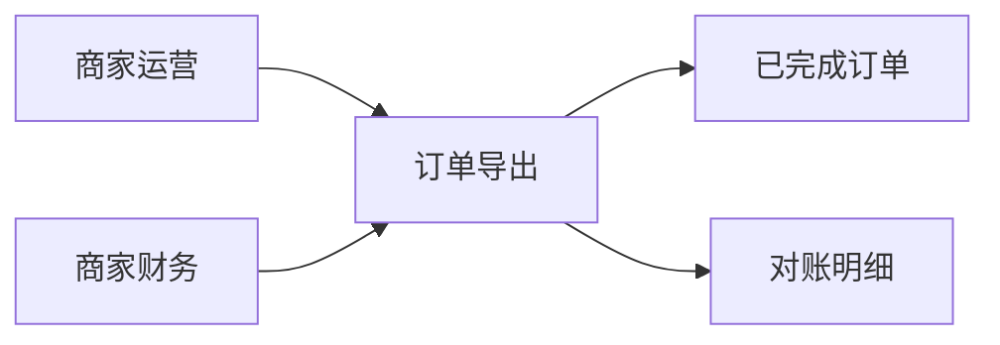
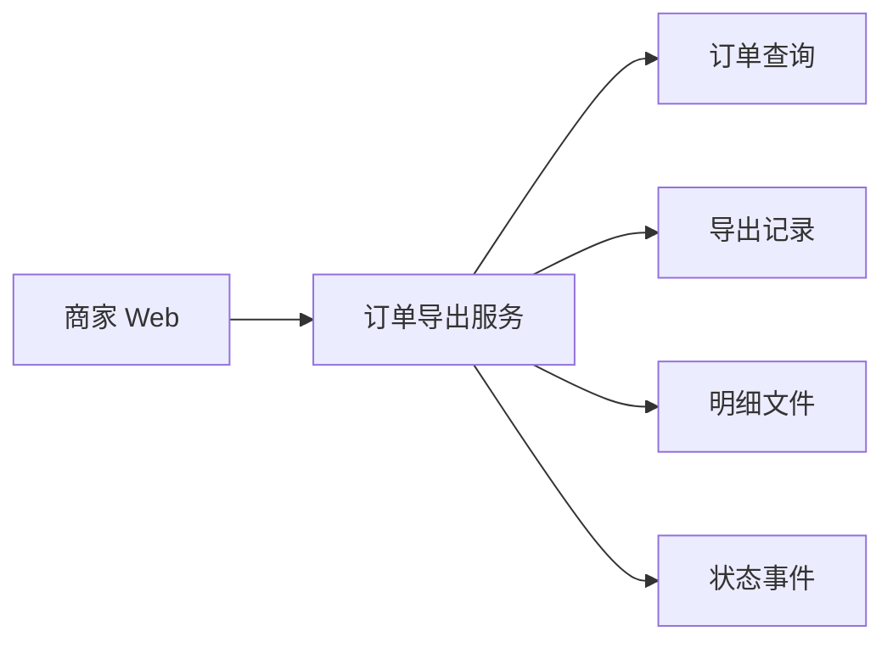

# 成稿示例：商家批量导出订单（技术规格）

须已有产品规格。下文只示范如何把业务合同落到契约与决策，不新增产品能力。路径、字段与状态码是教学契约，不是生产事实。不要抄进无关规格。同一事实只在一张表里展开。

依据的产品规格（摘录，不代替产品正文）：

- 验收 1：有订单查看权限、范围内有已完成订单、且没有同范围进行中或仍可取用的导出时，得到一份明细。明细只含已完成订单，含订单标识、创建日、金额、币种与完成时间，笔数与列表一致。
- 验收 2：同一次对账中再次索取同一范围时，若该次导出仍可取用，得到的是同一次明细。
- 边界：无权；范围内无已完成订单；同范围进行中；同范围仍可取用；同范围已失败则允许新建；准备未完成（超时、缺失、笔数不一致）；撤销进行中；撤销已结束的导出；准备尚未完成时索取下载。
- 未决：成功后可取用的天数。闭合前不得把具体天数写成规则。

# 商家批量导出订单（技术规格）

依据产品规格：商家批量导出订单

## 1. 技术目标与范围

| 产品合同 | 技术上须保证 | 不在本期 |
|----------|--------------|----------|
| 验收 1 | 见接口表「创建」「下载」与字段表。下载行集只含已完成订单，行数等于同一筛选的列表笔数，列对应五项事实 | 不新增筛选维度；不导出未完成订单 |
| 验收 2 | 见错误表「进行中」「仍可取用」。返回已有导出，不新建 | 不提供产品未写的强制新建 |
| 产品边界各行 | 错误表逐行覆盖 | 不把可取用天数实现为到期 |

## 2. 业务架构图

本期能力落在订单导出、已完成订单与对账明细，故附图。图中不写接口。



## 3. 技术架构图

请求跨越商家 Web、订单导出服务、订单查询、导出记录、明细文件与状态事件，故附图。笔数以订单查询的既有「已完成」筛选为准。



## 4. 接口与数据契约

### 接口

| 操作 | 方法与路径 | 成功 | 失败见 | 产品合同 |
|------|------------|------|--------|----------|
| 创建导出 | `POST /merchant/orders/exports` | 202，`exportId`，`status: preparing` | 错误表 | 验收 1 |
| 查询导出 | `GET /merchant/orders/exports/{exportId}` | 200，当前 `status` 与笔数字段 | 错误表「标识无法对应」 | 验收 2 |
| 下载 | `GET /merchant/orders/exports/{exportId}/download` | 200，明细文件 | 错误表「准备中下载」「失败后下载」 | 验收 1 |
| 撤销 | `POST /merchant/orders/exports/{exportId}/cancel` | 200，`status: failed` | 错误表「撤销已结束」 | 边界：撤销 |

错误体为 `{ "error": { "code", "message" } }`。

### 字段与枚举

| 名称 | 含义 | 约束 |
|------|------|------|
| `exportId` | 一次导出 | 沿用时返回已有值 |
| `createdFrom`，`createdTo` | 时间范围 | `YYYY-MM-DD`，含两端，对应产品「创建日」 |
| `status` | 进度 | 仅 `preparing`、`ready`、`failed` |
| `orderCount` | 明细笔数 | `ready` 时等于同一筛选的列表笔数 |
| `reconciliationReady` | 可否作为对账明细 | 仅笔数一致且明细齐全时为真；仅此时进入 `ready` |
| 文件列 | 明细内容 | `orderId,createdAt,amount,currency,completedAt`，对应该五项事实 |
| `orders.read` | 订单查看权限 | 无此权限不得创建 |
| `shopId` | 店铺 | 只取认证上下文，请求体不含该字段 |
| `downloadableUntil` | 可取用期限 | 见未决表「可取用天数」 |

### 状态与错误

| 情形 | HTTP | error.code | 对外说明 | 是否创建或沿用 |
|------|------|------------|----------|----------------|
| 无订单查看权限 | 403 | `orders_read_forbidden` | 当前账号无权导出订单 | 不创建 |
| 范围内无已完成订单 | 422 | `no_completed_orders` | 该范围内没有可导出的已完成订单 | 不创建 |
| 相同范围正在准备 | 409 | `export_in_progress` | 已有相同范围的导出正在准备，请沿用该次 | 返回原 `exportId`，不新建 |
| 相同范围仍可取用 | 200 | — | — | 返回原 `exportId`，不新建 |
| 相同范围已失败 | 202 或 422 | — | — | 不沿用。有已完成订单则 202，与创建成功相同；无则 422，与「范围内无已完成订单」相同 |
| 标识无法对应一次导出 | 404 | `export_not_found` | 找不到该次导出 | 不创建。技术边界，不新增产品能力 |
| 准备中下载 | 409 | `export_not_ready` | 明细尚未准备完成，请稍后下载 | 不返回文件 |
| 失败后下载 | 409 | `export_failed` | 本次导出未完成，不能下载 | 不返回文件 |
| 撤销进行中 | 200 | 资源 `cancelled` | 本次导出已撤销 | `status` 变为 `failed` |
| 撤销已结束 | 409 | `export_not_cancellable` | 仅准备中的导出可以撤销 | 状态不变 |

失败原因码写入资源，不另占 HTTP。超时阈值见实现决策。

| 原因 | error.code |
|------|------------|
| 明细缺失 | `incomplete_source` |
| 笔数不一致 | `count_mismatch` |
| 超时 | `preparation_timeout` |
| 商家撤销 | `cancelled` |

### 事件

| 事件 | 载荷 | 何时发出 | 产品合同 |
|------|------|----------|----------|
| `ExportStatusChanged` | `exportId`，`status`（同 `ExportStatus`），可空 `error.code` | `status` 变为 `preparing`、`ready` 或 `failed` | 商家得知准备中、可提交或未能完成。不新增产品能力 |

## 5. 模块边界与实现决策

- 模块：订单导出（新建：受理、迁移、下载、撤销）；订单查询（既有，只读已完成订单的笔数与明细）；商家 Web 导出面板（展示三种结果、下载、撤销）；`merchant-contracts`（`ExportStatus`、错误体、`ExportStatusChanged`）。订单查询不写入导出状态。
- 契约取舍：产品「订单查看权限」对应 `orders.read`。同一店铺见字段表 `shopId`。笔数对照复用订单列表的已完成筛选，不另建导出口径。准备超时取自受理起 15 分钟仍未完成；该阈值不改变「超时则不提供可提交明细」。
- 状态与交互：`preparing` 期间拒绝新建。`ready` 且仍可取用则返回已有 `exportId`。`failed` 不参与沿用。进入 `ready` 时 `reconciliationReady` 为真，仅此时下载返回 200。

```text
preparing → ready     当笔数一致且明细齐全
preparing → failed    当失败原因码表中的任一原因
ready 与 failed 无出边
```

界面只表达产品已有的三种结果，不新增承诺：`preparing`「明细准备中」；`ready`「可下载」，并提示「可提交为对账明细」；`failed`「导出未完成」。

## 6. 测试决策与可核对检查项

### 测试决策

- 测什么：HTTP 状态、`error.code`、对外说明、`status`、文件行数、界面上的三种结果标签。
- 不测什么：调度次数、存储键、私有函数。
- 模块：订单导出 API；商家 Web 导出面板。
- 可对照的既有测试：订单列表按已完成与日期范围筛选；无订单查看权限时的拒绝；Web 上的订单状态标签。

### 可核对检查项

1. 验收 1：具备权限、范围合法、范围内有已完成订单、且没有可沿用导出时，创建返回 202 与 `preparing`。到达 `ready` 后下载返回 200，行数与列表笔数一致，列见字段表，且不含未完成订单。
2. 验收 2：同范围进行中或仍可取用时，返回已有 `exportId`，不新建。码与说明以错误表为准。
3. 产品边界各行的状态码与对外说明以错误表为准。此处不逐条复述。
4. 可取用天数未决：以未决表「可取用天数」为准。禁止把占位天数实现为规则。
5. 生产环境返回三种 `status` 之前，`merchant-contracts` 的 `ExportStatus` 须含 `preparing`、`ready`、`failed`。未知状态不得导致界面抛异常。
6. 打开 `izelzzz/merchant-api`（状态、错误码、下载）、`izelzzz/merchant-contracts`（枚举、错误体、事件）、`izelzzz/merchant-web`（三种结果的标签）。不核私有实现。

## 7. 未决、风险与依赖

| 类别 | 项 | 已掌握 | 待决、风险或依赖 | 责任人 | 期限 |
|------|----|--------|------------------|--------|------|
| 未决 | 可取用天数 | 产品规格第 4 节未闭合。闭合前 `downloadableUntil` 为 `null`，下载不因时间失效 | 禁止把任一占位天数写入默认值、配置或验收。产品闭合前不实现到期 | 商家产品定天数；实现在闭合后 | 2026-10-21 |
| 风险 | 列表筛选与导出筛选分叉 | 验收要求笔数与列表一致 | 若订单查询另行定义「已完成」，导出偏离验收 1 | 商家技术 | 实现时核对 |
| 依赖 | 订单列表的已完成筛选 | 导出复用该口径 | 列表口径变更会改变导出范围，须先改产品规格 | 商家订单查询 | 随列表变更 |

## 8. 技术决策日志

| 时间 | 实现取舍 | 相对哪条产品决策 | 决策人 |
|------|----------|------------------|--------|
| 2026-10-09 | 同一店铺取认证上下文中的店铺标识，请求体不接收该标识 | 产品规则「同一店铺、相同时间范围不得另建」 | 商家技术负责人 |
| 2026-10-09 | 准备超时取自受理起 15 分钟仍未完成，原因码 `preparation_timeout` | 产品边界「超时则不提供可提交明细」。阈值不改变「超时即失败」 | 商家技术负责人 |
| 2026-10-09 | 笔数对照复用订单列表的已完成筛选，不另建导出口径 | 验收 1「笔数与列表一致」 | 商家技术负责人 |
