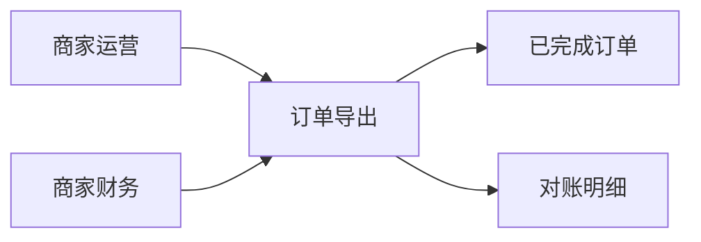
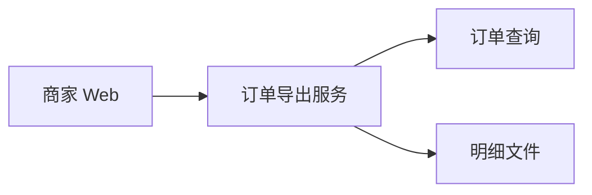

# 各段要求

产品规格已读过之后，先读该段的「写什么」「写到位的标志」「常见写法」「勿写」，再按「格式」与「示例」落笔。示例只示范详略。完整一篇见 [example.md](example.md)。不要把示例中的路径、字段与状态码抄进无关规格。

合同来自产品规格。技术规格不新增用户能力，不删除已承诺的结果。同一事实只放在一张表里，他处写「见某表」。实现取舍若改变用户可见结果，停止并回到 product-spec。

## 目录

- [1. 技术目标与范围](#1-技术目标与范围)
- [2. 业务架构图](#2-业务架构图)
- [3. 技术架构图](#3-技术架构图)
- [4. 接口与数据契约](#4-接口与数据契约)
- [5. 模块边界与实现决策](#5-模块边界与实现决策)
- [6. 测试决策与可核对检查项](#6-测试决策与可核对检查项)
- [7. 未决、风险与依赖](#7-未决风险与依赖)
- [8. 技术决策日志](#8-技术决策日志)

## 1. 技术目标与范围

### 写什么

- 每一条产品验收占一行，写技术上须保证的结果。
- 每一类产品边界占一行，指向后文的错误表，不在这里展开码表。
- 「不在本期」写明不新增的能力与不做的实现。

### 写到位的标志

- 产品规格中的每条验收都能在本表找到。
- 行内不出现产品规格没有的用户能力。
- 成功状态的对照与产品规格一致，没有换成另一套口径。

### 常见写法

- 产品合同列写「验收 n」或「边界：…」，不复述整段故事。
- 技术列指向接口表、字段表或错误表。
- 不在本期列用「不新增…」「不实现…」。

### 勿写

- 第二份产品规格。
- 把未决的业务问题在本表里定成规则。
- 没有验收编号或边界名称的空泛目标，例如「保证稳定」。

### 格式

| 产品合同 | 技术上须保证 | 不在本期 |
|----------|--------------|----------|

### 示例

| 产品合同 | 技术上须保证 | 不在本期 |
|----------|--------------|----------|
| 验收 1 | 见接口表「创建」「下载」与字段表。下载行数等于同一筛选的列表笔数 | 不新增产品未写的筛选；不导出未完成订单 |
| 产品边界各行 | 错误表逐行覆盖 | 不把产品未决的可取用天数实现为到期 |

## 2. 业务架构图

### 写什么

- 业务模块与能力边界如何落到系统。图仍须可读，不靠接口才能看懂。
- 复杂时必附 Mermaid。复杂指：业务模块不少于两个，或一项能力跨过不止一个系统边界。
- 不复杂时写「本期不附图」，并用一句话写清模块边界。

### 写到位的标志

- 能看出能力落在哪些模块，以及模块之间传递什么业务结果。
- 没有把产品规格中的步骤流程图原样再画一遍。
- 不复杂时，一句话已经写清边界，且没有单节点图。

### 常见写法

- 先用一句说明为何附图，或为何不附图。
- `flowchart` 的节点用模块或能力名。
- 线的含义是业务依赖，例如「导出读取已完成订单」。

### 勿写

- 接口路径、状态码、字段、部署拓扑。
- 与产品流程图重复的逐步分支。
- 为凑图而画的单节点。

### 格式

一句说明，复杂时加一个 Mermaid 代码块。

### 示例

本期能力落在订单导出、已完成订单与对账明细，故附图。



## 3. 技术架构图

### 写什么

- 系统、服务、数据流与关键边界。
- 复杂时必附 Mermaid。复杂指：系统或服务不少于两个，或跨边界数据流不少于两条。
- 不复杂时写「本期不附图」，并用一句话写清系统边界。

### 写到位的标志

- 能指出请求或数据经过哪些系统，以及哪一条边界负责产品中的哪一种结果。
- 与业务架构图不重复：本图用系统与数据流，不用角色步骤。
- 不复杂时已写明边界，且没有单节点图。

### 常见写法

- 先用一句说明为何附图，或为何不附图。
- 节点用系统或服务名。线写数据或调用方向。
- 关键边界在图旁用一句话点明，例如「笔数以订单查询的既有筛选为准」。

### 勿写

- 把业务架构图再贴一次。
- 源码目录、部署步骤、机器规格。
- 图中写完整错误码表。

### 格式

一句说明，复杂时加一个 Mermaid 代码块。

### 示例

请求跨越商家 Web、订单导出服务与订单查询，故附图。



## 4. 接口与数据契约

### 写什么

- 覆盖产品验收与边界所需的 API、字段、枚举、状态码、事件 Schema。
- 一行一条。详细可以，用表，不写散文。
- 错误表的情形列回指产品边界。事件只在产品结果需要跨端可见时才列。

### 写到位的标志

- 每一条产品验收和每一条边界都能指到表中的一行。
- 字段能对上产品要求的业务事实，没有多出来的用户能力。
- 错误码与对外说明在全篇只有一处展开。

### 常见写法

- 四张表：接口、字段与枚举、状态与错误、事件。没有事件时，事件小节写「本期不产生跨端事件」，并说明状态只在同步响应中返回。
- 接口表列：操作、方法与路径、成功结果、失败指向、对应的产品合同。
- 错误表列：情形、HTTP 状态、`error.code`、对外说明、是否创建或沿用。
- 同一状态下的多种失败原因，若状态码与说明相同，合成一行；不同则分行。

### 勿写

- 把同一状态码写成段落，并在实现决策和检查项里各抄一遍。
- 产品规格未写的用户能力。
- 源码路径、存储键、私有函数名。
- 没有对应产品边界的错误码。

### 格式

```markdown
### 接口
| 操作 | 方法与路径 | 成功 | 失败见 | 产品合同 |

### 字段与枚举
| 名称 | 含义 | 约束 |

### 状态与错误
| 情形 | HTTP | error.code | 对外说明 | 是否创建或沿用 |

### 事件
| 事件 | 载荷 | 何时发出 | 产品合同 |
```

错误体固定为 `{ "error": { "code", "message" } }`。沿用已有结果时同时返回该次标识。无事件则不要空表。

### 示例

| 操作 | 方法与路径 | 成功 | 失败见 | 产品合同 |
|------|------------|------|--------|----------|
| 创建导出 | `POST /merchant/orders/exports` | 202，返回 `exportId`，`status: preparing` | 错误表 | 验收 1 |

| 名称 | 含义 | 约束 |
|------|------|------|
| `status` | 一次导出的进度 | 仅 `preparing`、`ready`、`failed` |

## 5. 模块边界与实现决策

### 写什么

- 模块职责：新建或既有，以及本模块不做什么。
- 把产品规则落到契约的取舍：权限如何对应、阈值、状态如何迁移。
- 取舍不重复第 4 节的表。表已写的事实，这里只保留决定。

### 写到位的标志

- 能指出哪个模块保证哪一条产品合同。
- 状态迁移的条件与产品边界一致。
- 没有源码路径，也没有第二份错误码表。

### 常见写法

- 短列表：模块、契约取舍、状态与交互。
- 状态迁移用三五行文本，只保留决定。
- 阈值类决定写明它实现的是哪一条产品边界，以及它不改变哪一种用户可见结果。

### 勿写

- 完整实现、部署手册、可运行代码。
- 改变用户可见结果却不回改产品规格。
- 把第 4 节的字段表再列一遍。

### 格式

```markdown
- 模块：
- 契约取舍：
- 状态与交互：
```

### 示例

- 模块：订单导出（新建：受理、迁移、下载、撤销）；订单查询（既有，只读已完成订单的笔数与明细）。
- 契约取舍：产品「订单查看权限」对应 `orders.read`。准备超时取自受理起 15 分钟仍未完成。该阈值不改变「超时则不提供可提交明细」。
- 状态与交互：`preparing` 可到 `ready` 或 `failed`。`ready` 与 `failed` 无出边。仅 `ready` 且笔数一致、明细齐全时提供文件。

## 6. 测试决策与可核对检查项

### 写什么

- 测试决策写外部行为、被测模块、不测的内部实现，以及可对照的既有测试。
- 可核对检查项编号列出。每条指向契约表或产品验收，并能判定通过或失败。
- 列出须打开的仓库或产品表面。没有仓库名时写产品表面，并标明仍须确认的仓库。

### 写到位的标志

- 合格测试不断言私有实现。
- 检查项覆盖每条产品验收，且不把错误表再抄一遍。
- 审查表面具体到仓库或页面，而不是「相关服务」。

### 常见写法

- 测试决策用短列表。
- 检查项句式：`<产品合同>`：`<可观察结果>`。见 `<某表>`。
- 与错误表相同的码，检查项只写「以错误表为准」。

### 勿写

- 「提高覆盖率」，且没有外部行为。
- 断言调度次数、存储键或私有函数。
- 把接口表、错误表整表粘贴到检查项。

### 格式

```markdown
### 测试决策
- 测什么：
- 不测什么：
- 模块：
- 可对照的既有测试：

### 可核对检查项
1. …
```

### 示例

- 测什么：HTTP 状态、`error.code`、对外说明、`status`、文件行数、界面上的结果标签。
- 不测什么：调度次数、存储键、私有函数。

1. 验收 1：创建与下载的结果见接口表，行数与列表笔数一致。
2. 产品边界各行的状态码与说明以错误表为准，此处不逐条复述。

## 7. 未决、风险与依赖

### 写什么

- 未决：产品规格尚未闭合的事项。写已掌握事实、待决问题、禁止实现的假设、责任人与期限。
- 风险：何种偏离会使哪一条验收失败。
- 依赖：须先存在的能力。对方变更若会改变用户可见结果，写明须先改产品规格。

### 写到位的标志

- 产品规格中的每一条未决在本表有一行，且含禁止实现的假设。
- 没有把未决写成默认值。
- 风险与依赖能指到具体的产品合同。

### 常见写法

- 类别只使用：未决、风险、依赖。
- 禁止实现的假设写在「待决、风险或依赖」列，句式：禁止把…实现为规则。

### 勿写

- 只写「TBD」。
- 用技术默认值填上产品未决。
- 与本案验收无关的通用风险，例如「注意性能」。

### 格式

| 类别 | 项 | 已掌握 | 待决、风险或依赖 | 责任人 | 期限 |
|------|----|--------|------------------|--------|------|

### 示例

| 类别 | 项 | 已掌握 | 待决、风险或依赖 | 责任人 | 期限 |
|------|----|--------|------------------|--------|------|
| 未决 | 可取用天数 | 产品规格尚未闭合。闭合前不因时间拒绝下载 | 禁止把任一占位天数写入默认值或验收 | 商家产品定天数；闭合前不实现到期 | 2026-10-21 |

## 8. 技术决策日志

### 写什么

- 相对某条产品决策的实现取舍。先追加一行，再改正文。
- 写明该取舍不改变哪种用户可见结果。若会改变，本行不成立，改回 product-spec。

### 写到位的标志

- 能看出实现上改了什么、对应哪条产品决策、谁决定。
- 日志中的取舍在契约或实现决策中找得到。
- 未闭合的未决没有被写成已决。

### 常见写法

- 四列表。新决定追加在表末。同一天的不同取舍分行。
- 「相对哪条产品决策」点名验收、规则或边界，不复述全文。

### 勿写

- 只改正文，不追加日志。
- 把产品范围变更记在这里，代替产品规格的决策日志。
- 理由写成「实现更方便」，且没有指向产品合同。
- 粘贴实现代码或源码路径。

### 格式

| 时间 | 实现取舍 | 相对哪条产品决策 | 决策人 |
|------|----------|------------------|--------|

### 示例

| 时间 | 实现取舍 | 相对哪条产品决策 | 决策人 |
|------|----------|------------------|--------|
| 2026-10-09 | 准备超时取自受理起 15 分钟仍未完成 | 产品边界「超时则不提供可提交明细」。阈值不改变「超时即失败」 | 商家技术负责人 |
